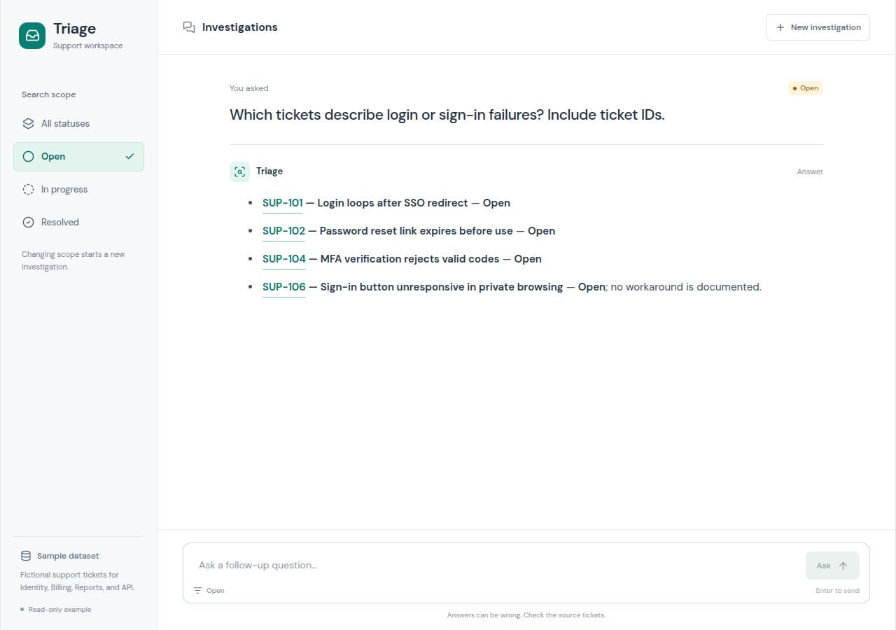
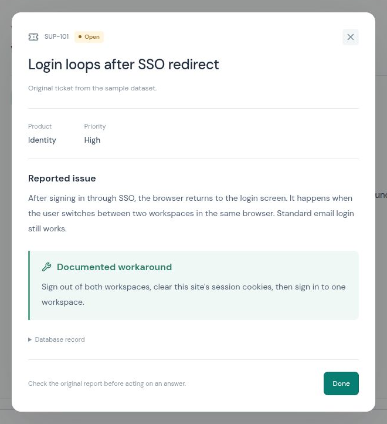

import FilteredTextBlock from '@site/src/components/Documentation/FilteredTextBlock';
import ServiceCode from '!!raw-loader!/docs/query-agent/_includes/code/support_tickets/tickets/service.py';
import StateCode from '!!raw-loader!/docs/query-agent/_includes/code/support_tickets/tickets/state.py';

Several users report that they can't sign in. Before investigating a new report, you want to find related tickets and see whether anyone has documented a workaround.

In this tutorial, you'll build a support-ticket explorer with [Reflex](https://reflex.dev/) and the [Weaviate Query Agent](../index.md). You'll filter tickets by status, ask questions in natural language, and check answers against the original records. Reflex handles the interface and session state in Python; the Query Agent searches the ticket collection and streams its answer.

You should be comfortable with Python functions and classes. You don't need prior Reflex experience.

[Get the complete app on GitHub](https://github.com/reflex-dev/reflex-weaviate), including the sample tickets and setup instructions.

## What you'll build

The sidebar sets the ticket status to search, and the question box stays at the bottom as you read. Select a linked ticket ID directly in the answer to open its recorded issue and workaround. The example is read-only: it helps you investigate tickets but doesn't change their status or contact customers.



*Figure 1. Narrow the search to open tickets, ask a question, then inspect the records behind the answer.*

You'll use 24 fictional tickets bundled with the example. They cover Identity, Billing, Reports, and API issues. No customer data, external datasets, or image downloads are needed.

## Before you start

You'll need:

- Python 3.14 or later, Git, and [uv](https://docs.astral.sh/uv/getting-started/installation/).
- A [Weaviate Cloud cluster](https://console.weaviate.cloud/) with Query Agent access, Weaviate Embeddings enabled, and one available collection slot.
- Your cluster URL and API key.

Query Agent is a hosted service; a local Weaviate database alone isn't enough. This example uses Weaviate Embeddings, so you don't need a separate model provider key. Imports and agent calls consume your Cloud service allowance.

## Run the example

Start with the complete app. Later sections explain selected parts of its implementation; you don't need to assemble the snippets into another file.

### 1. Get the source

Clone the [complete example repository](https://github.com/reflex-dev/reflex-weaviate):

```bash
git clone https://github.com/reflex-dev/reflex-weaviate.git
cd reflex-weaviate
uv sync --locked
```

Keep your terminal in this directory. The lockfile records the dependency versions used by the example.

### 2. Configure the connection

Copy the environment template:

```bash
cp .env.example .env
```

On Windows, you can copy and rename the file in your file manager. Edit `.env`:

```dotenv
WEAVIATE_URL=https://your-cluster.weaviate.network
WEAVIATE_API_KEY=your-api-key
```

The Python backend reads these values. `.env` is excluded from Git; don't put the key in frontend code or commit it.

### 3. Load the sample tickets

```bash
uv run python -m tickets.load_data
```

On the first run, expect:

```text
Tickets inserted: 24
ReflexSupportTickets: total 24
```

The loader creates one collection, `ReflexSupportTickets`, and imports `tickets/sample_tickets.json`. Each record has these properties:

| Property | Purpose |
| --- | --- |
| `ticket_id` | A readable identifier such as `SUP-101` |
| `title`, `description` | The issue the user reported |
| `status` | `Open`, `In progress`, or `Resolved` |
| `priority` | `High`, `Medium`, or `Low` |
| `product` | `Identity`, `Billing`, `Reports`, or `API` |
| `workaround` | A recorded workaround; empty when none is documented |

Weaviate Embeddings creates vectors from the text for similarity search. Status uses field tokenization so the app can match the whole value, including `In progress`.

Ticket IDs produce deterministic object IDs. A repeat import skips existing IDs and reports zero inserts. It doesn't update existing ticket contents or delete collections. The loader also refuses to use an existing collection without this tutorial's description marker.

### 4. Start the app

```bash
uv run reflex run --env prod --single-port
```

Open the URL printed by Reflex, normally `http://localhost:3000`. The first run builds the frontend. Production mode doesn't reload changed code; restart the process after editing Python or CSS.

## Investigate a login problem

Select **Open**, then ask:

> Which tickets describe login or sign-in failures? Include ticket IDs.

The app displays progress while the agent searches, then streams the answer. Once source details arrive, matching ticket IDs in the answer become clickable. Exact wording and the number of retrieved records can vary.

Select a linked ticket ID to check the answer. For example, `SUP-101` describes an SSO redirect loop and records a session-cookie workaround. `SUP-106` describes an unresponsive sign-in button but has no documented workaround. A useful answer should preserve that distinction.



*Figure 2. The dialog separates the reported issue from its recorded workaround. Expand **Database record** to inspect the collection and object ID.*

Ask a follow-up:

> Which of those tickets have a documented workaround?

The app includes completed exchanges from this session in the next request. Now select **Resolved** and repeat the first question. Changing the status clears the conversation, so previous answers about open tickets don't become context for a different subset.

The app asks the agent to evaluate its answer and narrow the source list to relevant records. This extra model step can add latency and usage; it does not guarantee correctness or provide a sentence-by-sentence citation map. The app resolves details for up to eight distinct tickets; count-only answers may have no individual sources.

## How the app works

| File | Responsibility |
| --- | --- |
| `tickets/tickets.py` | Status controls, question form, inline ticket references, and source dialogs |
| `tickets/state.py` | Session history, filter changes, and streamed UI updates |
| `tickets/service.py` | Shared connection, per-request filters, and source lookup |
| `tickets/load_data.py` | Collection schema and import of the bundled fixture |

### Constrain retrieval with a status filter

A prompt asking for open tickets relies on the model to apply that restriction. The status control instead passes a database filter through `QueryAgentCollectionConfig`:

<FilteredTextBlock text={ServiceCode.replace(/^ {8}/gm, '')} startMarker="# START StatusFilter" endMarker="# END StatusFilter" language="py" title="tickets/service.py: apply the selected status" />

`status_filter()` validates the value against the app's allowed statuses. It returns `Filter.by_property("status").equal(status)`, or `None` for **All statuses**. Weaviate combines this [additional filter](../reference/additional_filters.md) with the agent's own search filters.

`result_evaluation="llm"` asks the agent to compare its answer with the retrieved records and filter its source list. This helps reduce unrelated source records, but you should still check the answer.

The collection configuration is created for each request. Visitors can choose different statuses without mutating the shared agent. This is a search control, not user authorization; a real internal tool must enforce access separately on the server.

### Keep each investigation's context separate

[Reflex state](https://reflex.dev/docs/state/overview/) holds each visitor's question, status, and turns. Before starting a request, the handler builds context from completed turns among the six most recent exchanges:

<FilteredTextBlock text={StateCode.replace(/^ {12}/gm, '')} startMarker="# START ConversationHistory" endMarker="# END ConversationHistory" language="py" title="tickets/state.py: build follow-up context" />

Partial answers are excluded. The handler snapshots the selected status for the request, and status changes are disabled while an answer is running. When a visitor changes status, `set_status()` clears the previous turns. This keeps the conversation consistent with the selected subset.

History lasts for the browser session. This example does not store a permanent conversation archive.

### Stream the answer without blocking state updates

`State.ask` is a [Reflex background event](https://reflex.dev/docs/events/background-events/). It waits for network results outside the session's state lock and briefly acquires that lock to update the interface:

<FilteredTextBlock text={StateCode.replace(/^ {16}/gm, '')} startMarker="# START StreamPayloads" endMarker="# END StreamPayloads" language="py" title="tickets/state.py: handle streaming events" />

`ProgressMessage` updates the status text. `StreamedTokens` appends answer text. `AskModeResponse` supplies the final answer and source identifiers.

The form disables submission during a request, and the backend also rejects duplicate submissions. A `finally` block clears the busy state on success or failure. If a request fails, the app restores the question unless the visitor has already typed a new one.

### Inspect records instead of generating source details

The final response supplies collection names and object IDs. The source resolver deduplicates these identifiers, selects at most eight, and fetches their properties in one database query. It applies the same status filter to this lookup.

`source_card()` maps the returned properties into display fields. `link_tickets()` links ticket IDs only when a matching record was retrieved. Links are scoped to their conversation turn, and the original answer is preserved for follow-up context. The dialog shows the stored description and workaround directly; an empty workaround becomes **No workaround documented.** A missing record does not produce a clickable reference. If source lookup fails after an answer succeeds, the answer remains visible with an explanatory note.

The async client and agent are created lazily and reused within a server worker. Conversation history stays in session state, and a lifespan handler closes the client when the worker stops.

## Try other questions

Select **All statuses** to search the full sample, then try:

- “Which report export tickets have a documented workaround?”
- “Summarize the webhook delivery and signature problems. Include ticket IDs.”
- “Which billing issues are still open?”

Follow up with “What workaround is recorded for the first ticket?” to use the previous answer as context. Select a linked ticket ID to read the original report.

## Troubleshooting

| Symptom | What to check |
| --- | --- |
| The app asks for configuration | Set both values in `.env`, then retry. |
| The app asks you to load tickets | Run `uv run python -m tickets.load_data`. |
| Import reports a collection limit | Use a cluster with one available slot. The loader never deletes existing data. |
| A request fails or times out | Check connectivity, Query Agent access, and Cloud usage limits. |
| An answer has no clickable ticket IDs | An aggregate-only answer may have no individual sources. A failed source lookup displays a separate note. |
| Edited fixture data doesn't appear | Reruns skip existing IDs. Use explicit update operations to change already imported records. |

## Adapt it to your support workflow

Start by changing the fixture and schema to match your ticket fields. Keep statuses consistent and preserve a stable ticket ID. Add a product filter using the same per-request configuration pattern if you need a narrower search.

Before using real customer tickets, add authentication, server-enforced data access, and per-user request limits. Keep private ticket data out of the public example. Ticket editing and helpdesk synchronization can be separate features once the read-only workflow works.

## Further resources

- [Additional filters](../reference/additional_filters.md): restrict the records available to the Query Agent.
- [Multi-turn conversations](../reference/multi_turn_conversations.md): pass context with each question.
- [Reflex state](https://reflex.dev/docs/state/overview/): connect Python session data to the interface.
- [Reflex background events](https://reflex.dev/docs/events/background-events/): update the interface during asynchronous work.

## Questions and feedback

import DocsFeedback from '/_includes/docs-feedback.mdx';

<DocsFeedback />
