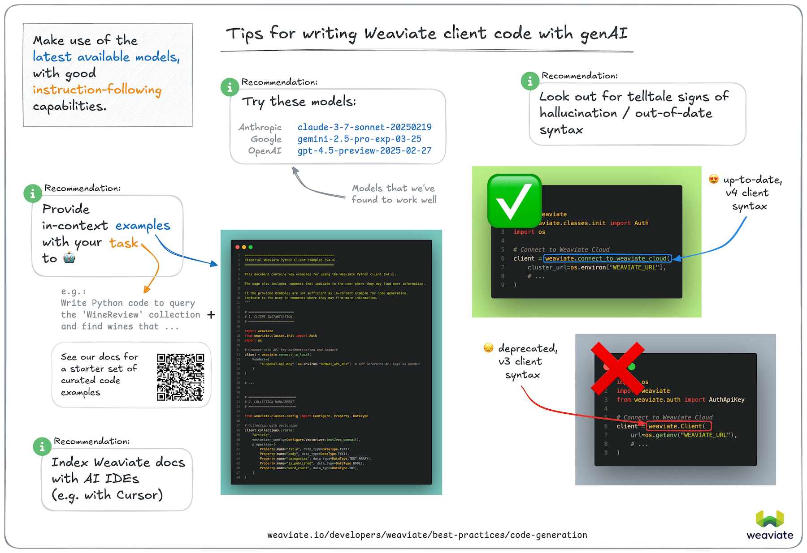

Generative AI models are becoming more capable at writing code. This practice is often referred to as "vibe-coding" or "AI-assisted coding". While this can speed up development, it is also subject to some pitfalls, such as hallucinations due to out-of-date, or missing information in the training data.

Here are some tips for writing Weaviate client library code with generative AI models and tooling, based on our anecdotal experience.



## Specific recommendations

### Weaviate MCP Servers

Weaviate provides two [MCP](https://modelcontextprotocol.io/) servers that integrate with AI development tools like Claude Code, Claude Desktop, Cursor, and VS Code:

- **[Weaviate MCP Server](../configuration/mcp-server.mdx)**: Built into Weaviate itself. Lets AI assistants inspect schemas, search data, and modify objects in your Weaviate instance directly. Enable with `MCP_SERVER_ENABLED=true`.
- **[Weaviate Docs MCP Server](../mcp/docs-mcp-server.mdx)**: A standalone server that gives AI assistants access to Weaviate's documentation, reducing hallucinations when generating Weaviate code.

### Weaviate Agent Skills

**[Weaviate Agent Skills](https://github.com/weaviate/agent-skills)** gives AI coding agents (Claude Code, Cursor, GitHub Copilot, and others) built-in knowledge of Weaviate, covering search, collection management, data import, and complete application blueprints such as RAG, agentic RAG, and chatbots. When the skill is installed, agents can discover and use it automatically, reducing hallucinations and speeding up Weaviate development.

Install with:

```bash
npx skills add weaviate/agent-skills
```

### High-performing models

To choose a model for the [Weaviate Python v4 client](/weaviate/client-libraries/python/index.mdx), start with the current [Claude](https://platform.claude.com/docs/en/about-claude/models/overview), [Gemini](https://ai.google.dev/gemini-api/docs/models), or [OpenAI](https://developers.openai.com/api/docs/models) model catalog.

Compare models on a task your application performs. For example, ask each model to write a query against a test collection using your installed client version. Run the generated code and check that it returns the objects you expect.

### In-context code examples

In our July 2025 evaluation, models generated working Python v4 client code more often when the prompt included relevant code examples.

As a starting point, we have curated a set of code examples below. Try copy and pasting this block of code into your prompt.

import CodeExamples from '!!raw-loader!/\_includes/code/python/best-practices.python.ai.py';
import CodeBlock from '@theme/CodeBlock';

<div style={{height: '300px', overflow: 'auto'}}>

<CodeBlock language="python">{CodeExamples}</CodeBlock>

</div>
<br/>

If the above code examples are not sufficient, you can try the following:

- Collect code examples from relevant sections of the Weaviate Documentation.
- Use the `Ask AI` feature in the Weaviate Documentation to find examples of how to perform specific tasks. Then, use the provided code in your prompt.

:::tip Small models
When evaluating a smaller model, try the same task with and without a working client example in the prompt.
:::

## General tips

Along with the specific recommendations above, we also have the following general tips:

### Use the latest models

You may already have a preferred model provider. Try out the latest models to see if they perform better for your use case.

Later models will be trained on more recent data, and are likely to be better at zero-shot code generation tasks. This is particularly important where the code base has been significantly updated, such as with the Weaviate Python client, which was rewritten in 2024.

### Look for better instruction-following models

Some models are better at following instructions provided as in-context examples.

These models are more likely to respect up-to-date examples provided as in-context instructions.

### Review the generated code for signs of hallucination

It is important to review the generated code for signs of hallucination.

For the Weaviate Python client, a telltale sign of hallucination, or out-of-date code is the use of `weaviate.Client` class for connecting to Weaviate. This was used in the older, v3 version of the client library and is not present in the v4 version.

The latest version of the Weaviate Python client uses `weaviate.connect_to_xyz()` helper functions to connect to Weaviate, using the `WeaviateClient` class.

### Index further documentation

Some AI-powered code generation tools such as Cursor allow you to index further documentation. This can be a great way to get more context for the code generation task. Then, you could prompt the IDE to generate code based on the indexed documentation.

Review the documentation of your specific IDE to see if it has this feature, and how to use it.

### Consider using the Query Agent

The [Query Agent](/query-agent) is a pre-built agentic search service that decides the search terms, filters, sorts, and other search parameters for you. The [modes overview](/query-agent/guides/index.md) covers what it can do.

The Query Agent is available to Weaviate Cloud users for interacting with their Weaviate Cloud instance in natural language. For some use cases, this may be a better approach than using AI-powered code generation tools.

## Help us improve this page

The above recommendations are based on our experience using generative AI models for code generation.

In order to collect data for this page in a systematic way, we ran a series of evaluations through [this repository](https://github.com/weaviate-tutorials/weaviate-vibe-eval).

The test were carried out by generating code for the Weaviate Python client v4 using various LLMs, and assessing whether the code was able to run successfully. Each task was carried out multiple times, once as a zero-shot task, and at least once with in-context examples.

A sampling of the results are collected [in this directory](https://github.com/weaviate-tutorials/weaviate-vibe-eval/tree/main/example_results).

Please note that this was a small-scale evaluations for providing guidelines only. If you are interested in running your own evaluations, please check out the repository.

If you have any questions or feedback, please let us know by opening an issue on [GitHub](https://github.com/weaviate-tutorials/weaviate-vibe-eval/issues).

## Questions and feedback

import DocsFeedback from '/\_includes/docs-feedback.mdx';

<DocsFeedback/>
