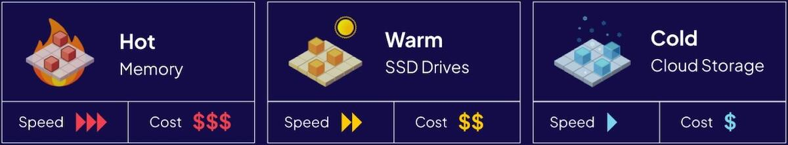

# Best practices & tips

This page covers what we consider general best practices for using Weaviate. They are based on our experience and the feedback we have received from our users.

:::info Consider this a hub for best practices
We will update this page over time as Weaviate evolves and we learn more about how our users are using it. Please check back regularly for updates.
:::

## Upgrades & maintenance

### Keep Weaviate and client libraries up-to-date

Weaviate is a fast-evolving product, where we are constantly adding new features, improving performance, and fixing bugs. We recommend keeping Weaviate and the client libraries you use up-to-date to benefit from the latest features and improvements.

To keep up-to-date with the latest releases, you can:

- Subscribe to the [Weaviate newsletter](https://newsletter.weaviate.io/)
- [Watch](https://docs.github.com/en/account-and-profile/managing-subscriptions-and-notifications-on-github/managing-subscriptions-for-activity-on-github/viewing-your-subscriptions#reviewing-repositories-that-youre-watching) the relevant Weaviate GitHub repositories. They are:
    - [Weaviate](https://github.com/weaviate/weaviate)
    - [Weaviate Python client](https://github.com/weaviate/weaviate-python-client)
    - [Weaviate TS/JS client](https://github.com/weaviate/typescript-client)
    - [Weaviate Go client](https://github.com/weaviate/weaviate-go-client)
    - [Weaviate Java client](https://github.com/weaviate/java-client)

:::info How often are new versions released?
Generally, a new minor version of Weaviate is released every 6-10 weeks, and new patch versions are regularly released.
:::

<!-- ### Plan for upgrades -->

## Resource management

### Use high availability clusters for speed and reliability

For environments with high reliability requirements, high query loads or latency requirements, consider deploying Weaviate in a high availability (HA) configuration. An HA configuration with multiple nodes provide several benefits:

- **Better fault tolerance**: Continue serving requests even if individual nodes experience issues
- **Rolling upgrades**: Individual nodes can be upgrades without cluster-level downtime
- **Improved query performance**: Distribute query load across multiple nodes to reduce latency
- **Increased throughput**: Handle more concurrent queries and data operations

:::tip Further resources
- [Concepts: Cluster architecture](../concepts/cluster.md)
- [Configuration: Replication](/deploy/configuration/replication.md)
:::

#### Replication settings

If using high availability (HA) configurations, consider the following replication settings:

- **Replication factor**: Set the replication factor to an odd number to ensure quorum (majority of cluster size) is possible without excessive replication. Note: If the number of nodes is fewer than the replication factor, Weaviate will not start.
- **Deletion strategy**: Use a deletion strategy that fits your use case. The `NoAutomatedResolution` strategy is generally recommended.

### Use multi-tenancy for data subsets

If your use cases involves multiple subsets of data which meet all of the following criteria:

- Have the same data structure (i.e. data schema)
- Can share the same settings (e.g. vector index, inverted index, vectorizer models, etc.)
- Do not need to be queried together

Then consider enabling multi-tenancy, and assigning each subset of data to a separate tenant. This will reduce the resource overhead on Weaviate, and allow you to scale more effectively.

<p align="center"></p>

:::tip Further resources
- [How-to: Perform multi-tenancy operations](../manage-collections/multi-tenancy.mdx)
- [How to: Manage tenant states](../manage-collections/tenant-states.mdx)
- [Concepts: Multi-tenancy](../concepts/data.md#multi-tenancy)
:::

### Set a vector index type to suit your data scale

When configuring a vector index, choose from the expected data volume per collection or tenant, the vector representation, the memory budget, and measured query latency. Object counts alone do not determine the best index.

- Consider `hnsw` when its graph and cached vector representations fit the memory budget with headroom for imports and queries.
- Consider `flat` for small collections or tenants. It avoids the HNSW graph, but scans eligible vectors; measure latency with your dimensions, filters, and expected data volume rather than relying on a fixed count.
- Consider `dynamic` when many collections or tenants start small and some may grow. It requires async indexing and makes a one-way, asynchronous transition from flat to HNSW. Budget for the HNSW stage and check the [documented limitations](../concepts/indexing/vector-index.md#dynamic-index), including lack of multi-vector support.
- Consider `hfresh` when the HNSW working set does not fit. It stores posting lists on disk while retaining a centroid index and metadata in memory. Compare recall, latency, and disk use with compressed HNSW on your storage, and check [supported distance metrics and multi-vector encoding](../concepts/indexing/vector-index.md#hfresh-index).

Revisit the choice when peak memory approaches the container limit, quality or latency misses its target, or disk use exceeds the budget. Measure with the filters, result limits, and concurrency the application will use.

:::tip Further resources
- [How-to: Set the vector index type](../manage-collections/vector-config.mdx#set-vector-index-type)
- [Concepts: Vector indexes](../concepts/indexing/vector-index.md)
:::

### Reduce memory footprint with vector quantization

As the size of your dataset grows, the accompanying vector indexes can lead to high memory requirements and thus significant costs. Especially if the `hnsw` index type is used.

If vector representations dominate memory, consider quantization. It can reduce the cached representation in HNSW, but does not shrink the graph or remove the original vectors from the object store. Measure total memory and disk use rather than applying a compression ratio to the whole instance.

If memory is your priority, you can also consider the disk-based [HFresh index](/weaviate/concepts/vector-index#hfresh-index), an index-level alternative to quantization for reducing the memory footprint.


For HNSW indexes, consider 8-bit [rotational quantization (RQ)](../configuration/compression/rq-compression.md) when vector payload dominates memory. It needs no training data, but its effect on quality depends on the data and search settings. Measure [top-k overlap with an exact reference](../starter-guides/managing-resources/compression.mdx#recall) and application relevance before relying on it.

import CompressionByDefault from '/_includes/compression-by-default.mdx';

<CompressionByDefault/>

:::tip Further resources
- [How-to: Configure vector quantization](../configuration/compression/index.md)
- [Concepts: Vector quantization](../concepts/vector-quantization.md)
:::

### Customize system thresholds to prevent downtime

Weaviate is configured to emit warnings, or to even go into read-only mode when certain thresholds (in percentage) are exceeded for memory or disk usage.

These thresholds can be adjusted to better fit your use case. For example, if you are running Weaviate on a machine with a large amount of memory, you may want to increase the memory threshold before Weaviate goes into read-only mode. This is because the same percentage of memory usage will represent a larger amount of memory on a machine with more memory.

Set `DISK_USE_WARNING_PERCENTAGE` and `DISK_USE_READONLY_PERCENTAGE` to adjust the disk usage thresholds, and `MEMORY_WARNING_PERCENTAGE` and `MEMORY_READONLY_PERCENTAGE` to adjust the memory usage thresholds.

:::tip Further resources
- [References: Environment variables](/deploy/configuration/env-vars/index.md#general)

:::

### Plan memory allocation

Start from vector payload, then add the other components. For uncompressed `float32` vectors:

- 1 million 1,024-dimensional vectors contain `1e6 * 1024 * 4 B = 4.096 GB` of values.
- 1 million 256-dimensional vectors contain `1e6 * 256 * 4 B = 1.024 GB` of values.

These figures use decimal GB and cover payload only, not an instance's memory requirement. Add graph structures, cache bookkeeping, object and property indexes, runtime allocations, and import/query peaks. Count each named vector and the component or encoded vectors used by the index. For a node's budget, count every shard replica it hosts rather than dividing cluster memory by node count. Compression changes the vector representation, not all these components in the same ratio.

:::tip Further resources
- [Concepts: Resource planning](../concepts/resources.md)
:::

### How to quickly check the memory usage

In production settings, you should set up cluster [monitoring](/deploy/configuration/monitoring.md) with tools such as Grafana & Prometheus.

There are, however, other ways to quickly check Weaviate's memory usage.

:::note If you have Prometheus monitoring setup already
`go_memstats_heap_inuse_bytes` reports in-use Go heap spans, not total process or container memory. It is also different from the live-heap measure used by Weaviate's memory checks. Use Go runtime metrics to investigate heap pressure, and monitor process RSS and container memory separately, including file-cache use. Do not compare any one of these directly with raw vector payload as if they measured the same allocation.
:::

#### Through `pprof`

If `go` is available to your system, you can view the heap profile with golang's `pprof` tool".

- Have a go runtime installed, or start a Go-based docker container
- Expose port 6060 if running in docker/k8s

:::caution `DEBUG_ENDPOINTS_ENABLED` required in `v1.37.9`+
As of `v1.37.9`, the debug HTTP listener (including the `/debug/pprof/*` endpoints) is disabled by default. Set [`DEBUG_ENDPOINTS_ENABLED=true`](/deploy/configuration/env-vars/index.md) to serve these endpoints before profiling.
:::

To view the profile visually:

```bash
go tool pprof -png http://{host}:6060/debug/pprof/heap
```

Or to view a textual output:

```bash
go tool pprof -top http://{host}:6060/debug/pprof/heap
```

#### Check the container usage

In Kubernetes, monitor container memory against the configured container limit. If Metrics Server is installed, you can inspect per-container usage with:

```bash
kubectl top pod weaviate-0 --containers
```

Use the appropriate namespace and pod name for your deployment. `free` inside a container can report host-level memory rather than the container's limit, so it is not a substitute for container metrics.

Container working-set metrics, process RSS, and Go heap profiles measure different things. Inspect file-cache and other non-heap allocations as well as the heap, and measure peaks during representative imports and queries before setting a production limit.

### Configure shard loading behavior to balance system & data availability

:::info Added in `v1.36.6`
:::

When Weaviate starts, it loads data from all shards in your deployment. Starting in v1.36.6, Weaviate uses [dynamic lazy shard loading](../concepts/storage.md#dynamic-lazy-shard-loading) to automatically decide per collection whether to load shards eagerly or lazily, based on shard count and size thresholds.

By default, shards are **eagerly loaded** (synchronously) until a collection exceeds either:
- **1,000 shards** (`LAZY_LOAD_SHARD_COUNT_THRESHOLD`)
- **100 GB total shard size** (`LAZY_LOAD_SHARD_SIZE_THRESHOLD_GB`)

This default provides better query and ingestion reliability during rolling restarts and upgrades. For large multi-tenant deployments that exceed these thresholds, lazy loading activates automatically.

If you need to force lazy loading for all collections (e.g., very large clusters), set:

```
LAZY_LOAD_SHARD_COUNT_THRESHOLD: "0"
```

:::note
The `DISABLE_LAZY_LOAD_SHARDS` environment variable is deprecated as of v1.36.6. Weaviate now auto-detects when lazy loading is needed per collection.
:::

## Data structures

### Cross-references vs flattened properties

When designing your data schema, consider whether to use cross-references or flattened properties. If you come from a relational database background, you may be tempted to normalize your data and use cross-references.

However, in Weaviate, cross-references can have multiple drawbacks:

- They are not vectorized, which means that this information is not incorporated as a part of the vector representation of the object.
- They can be slow to query, as they require additional queries to fetch the referenced object. Weaviate is not designed for graph-like queries or joins.

Instead, consider directly embedding the information in each object as another property. This will ensure that the information is vectorized, and can be queried more efficiently.

<!-- ### Choose the right property data type -->

<!-- ## Optimize queries -->

<!-- ### Index the right properties -->

## Data operations

### Explicitly define your data schema

Weaviate includes a convenient ["auto-schema" functionality](../config-refs/collections.mdx#auto-schema) that can automatically infer the schema of your data.

However, for production use cases, we recommend explicitly defining your schema, and disabling the auto-schema functionality (set `AUTOSCHEMA_ENABLED: 'false'`). This will ensure that your data is correctly interpreted by Weaviate, and that malformed data is not ingested into the system, rather than to potentially create unexpected properties.

As an example, consider importing the following two objects:

```json
[
    {"title": "The Bourne Identity", "category": "Action"},
    {"title": "The Bourne Supremacy", "cattegory": "Action"},
    {"title": "The Bourne Ultimatum", "category": 2007},
]
```

In this case, the second and third objects are malformed. The second has a typo in the property name `cattegory`, and the third has a category that is a number, rather than a string.

If you have auto-schema enabled, Weaviate will create a property `cattegory` in the collection, which can lead to unexpected behavior when querying the data. And the third object could lead to the creation of a property `category` with a data type of `INT`, which is not what you intended.

Instead, disable auto-schema, and define the schema explicitly:

```python
from weaviate.classes.config import Property, DataType

client.collections.create(
    name="WikiArticle",
    properties=[
        Property(name="title", data_type=DataType.TEXT),
        Property(name="category", data_type=DataType.TEXT),
    ],
)
```

This will ensure that only objects with the correct schema are ingested into Weaviate, and the user will be notified if they try to ingest an object with a malformed schema.

:::tip Further resources
- [Concepts: Data schema](../concepts/data.md#data-schema)
- [References: Collection definition - Auto-schema](../config-refs/collections.mdx#auto-schema)
:::

### Accelerate data ingestion with batch imports

When importing any significant amount of data (i.e. more than 10 objects), use batch imports. This will significantly improve your import speed for two reasons:

- You will be sending fewer requests to Weaviate, which reduces the overhead of the network.
- If Weaviate orchestrates data vectorization, it can in turn send vectorization requests in batches, which can be significantly faster, especially where inferences are done with GPUs.

```python
# ⬇️ Don't do this
for obj in objects:
    collection.data.insert(properties=obj)

# ✅ Do this: server-side batching (recommended) - the server
# tells the client how much data to send next
with collection.batch.stream() as batch:
    for obj in objects:
        batch.add_object(properties=obj)

# ✅ Or, if your objects are already in an in-memory list,
# ingest the whole list with a single call
result = collection.data.ingest(objects)
```

[Server-side batching](../concepts/data-import.mdx#server-side-batching) requires Weaviate `v1.36` or later and a client that supports it. If it is not available, use a client-side batching method such as `collection.batch.fixed_size(batch_size=200)` or `collection.batch.dynamic()` instead.

Avoid passing large lists to `collection.data.insert_many()`. It sends all objects in a single request, which fails if the request exceeds the server's [`GRPC_MAX_MESSAGE_SIZE`](/deploy/configuration/env-vars/index.md#GRPC_MAX_MESSAGE_SIZE) limit. `collection.data.ingest()` is a drop-in replacement that does not have this limitation.

:::tip Further resources
- [How-to: Batch import data](../manage-objects/import.mdx)
- [Concepts: Data import](../concepts/data-import.mdx)
:::

### Minimize costs by offloading inactive tenants

If you are using multi-tenancy, and have tenants that are not being queried frequently, consider offloading them to cold (cloud) storage.



Offloaded tenants are stored in a cloud storage bucket, and can be reloaded into Weaviate when needed. This can significantly reduce the memory and disk usage of Weaviate, and thus reduce costs.

When the tenant is likely to be used again (e.g. when a user logs in), it can be reloaded into Weaviate, and will be available for querying again.

:::info Available in open-source Weaviate only
At the moment, offloading tenants is only available in the open-source version of Weaviate. We plan to make this feature available in Weaviate Cloud.
:::

:::tip Further resources
- [Starter guide: Managing resources](../starter-guides/managing-resources/index.md)
- [How-to: Manage tenant states](../manage-collections/tenant-states.mdx)
:::

<!-- ### Data validation strategies -->

<!-- ## Queries

### Consider using a reranker

### Effective hybrid search strategies -->

## Application design and integration

### Minimize client instantiations

There is a performance overhead when instantiating a Weaviate client object, due to the I/O operations to establish a connection and perform health checks.

Where possible, reuse the same client object for as many operations as you can. Generally, the client object is thread-safe and can be used in parallel across multiple threads.

If multiple client objects are absolutely necessary, consider skipping initial checks (e.g. [Python](../client-libraries/python/notes-best-practices.mdx#initial-connection-checks)). This can significantly reduce the overhead of instantiating multiple clients.

Note that there may be some client library-specific limitations. For example, the Weaviate Python client should only be used with [one batch import thread per client object](../client-libraries/python/notes-best-practices.mdx#thread-safety).

Additionally, you should [consider the asynchronous client API](#use-the-relevant-async-client-as-needed) to improve performance in asynchronous environments.

### Use the relevant Async Client as needed

When using Weaviate in an asynchronous environment, consider using the asynchronous client API. This can significantly improve the performance of your application, especially when making multiple queries in parallel.

#### Python

The Weaviate Python client includes an [asynchronous client API (`WeaviateAsyncClient`)](../client-libraries/python/async.md).

#### Java

The Weaviate Java client includes an [asynchronous client API (`WeaviateClientAsync`)](https://javadoc.io/doc/io.weaviate/client6/latest/io/weaviate/client6/v1/api/WeaviateClientAsync.html).

## Questions and feedback

import DocsFeedback from '/_includes/docs-feedback.mdx';

<DocsFeedback/>
