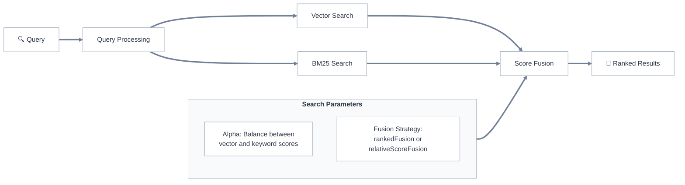

Hybrid search combines [vector search](./vector-search.md) and [keyword search (BM25)](./keyword-search.md) to leverage the strengths of both approaches. This takes into account results' semantic similarity (vector search) and exact keyword relevance (BM25), providing more comprehensive search results.

A hybrid search runs its enabled search components in parallel and combines their scores to produce a base ranking. At `alpha=0` or `alpha=1`, only one component runs. Optional result refinement can change the final ranking or selection.

## How hybrid search works

In Weaviate, a hybrid search performs the following steps:

1. Executes the enabled search components in parallel (at `alpha=0` or `alpha=1`, only one component runs):
   - Vector search to find semantically similar content
   - BM25 search to find keyword matches
1. Combines the result sets using a [fusion method](#fusion-strategies)
1. Produces a base ranking from the combined scores

Optional [Boost](../../search/boost.md), [MMR diversity selection](../../search/hybrid.md#diversity-selection-mmr), or [reranking](../../search/rerank.md) can refine the candidate ranking or selection. The final response therefore need not remain in fused-score order; these stages cannot recover objects absent from retrieval candidates.

### Fusion strategies

Weaviate supports two strategies (`relativeScoreFusion` and `rankedFusion`) for combining vector and keyword search scores:

With `relativeScoreFusion` (default from `v1.24`), each retrieved component result set is normalized separately. Higher BM25 scores and higher vector similarity (smaller vector distance) receive larger contributions: the best value becomes 1, the worst becomes 0, and intermediate values are scaled between them. If all values in a component are equal, each receives its full component weight. The final score is the alpha-weighted sum of normalized vector similarity and normalized BM25 score. Normalization uses retrieved candidates, not the entire collection or necessarily just the displayed page.

With `rankedFusion` (default for `v1.23` and lower), each object is scored according to its position in the results for the given search, starting from the highest score for the top-ranked object and decreasing down the order. The total score is calculated by adding these rank-based scores from the vector and keyword searches.

Generally, `relativeScoreFusion` might be a good choice, which is why it is the default.

The main reason is that `relativeScoreFusion` retains more information from the original searches than `rankedFusion`, which only retains the rankings. More generally we believe that the nuances captured in the vector and keyword search metrics are more likely to be reflected in rankings produced by `relativeScoreFusion`.

We include a concrete example of the two fusion strategies below.

### Fusion example

Assume `alpha=0.5` (equal component weights), not the server default. A search retrieves **five objects** with **document id** (from 0 to 4). The following tables show component scores **before alpha weighting**. The vector values are higher-is-better similarity scores, not lower-is-better distances. Each row is **ordered by score**:

<table>
  <tr>
    <th>Search Type</th>
    <th>(id): score</th><th>(id): score</th><th>(id): score</th><th>(id): score</th><th>(id): score</th>
  </tr>
  <tr>
    <td>Keyword</td>
    <td>(1): 5</td><td>(0): 2.6</td><td>(2): 2.3</td><td>(4): 0.2</td><td>(3): 0.09</td>
  </tr>
  <tr>
    <td>Vector</td>
    <td>(2): 0.6</td><td>(4): 0.598</td><td>(0): 0.596</td><td>(1): 0.594</td><td>(3): 0.009</td>
  </tr>
</table>

#### Ranked fusion

The unweighted contribution depends on the zero-based rank of each result and is computed as `1/(RANK + 60)`, resulting in:

<table>
  <tr>
    <th>Search Type</th>
    <th>(id): score</th><th>(id): score</th><th>(id): score</th><th>(id): score</th><th>(id): score</th>
  </tr>
  <tr>
    <td>Keyword</td>
    <td>(1): 0.016667</td><td>(0): 0.016393</td><td>(2): 0.016129</td><td>(4): 0.015873</td><td>(3): 0.015625</td>
  </tr>
  <tr>
    <td>Vector</td>
    <td>(2): 0.016667</td><td>(4): 0.016393</td><td>(0): 0.016129</td><td>(1): 0.015873</td><td>(3): 0.015625</td>
  </tr>
</table>

As you can see, the results for each rank are identical, regardless of the input score.

#### Relative score fusion

In relative score fusion, the largest score is set to 1 and the lowest to 0, and all entries in-between are scaled according to their **relative distance** to the **maximum** and **minimum values**.

<table>
  <tr>
    <th>Search Type</th>
    <th>(id): score</th><th>(id): score</th><th>(id): score</th><th>(id): score</th><th>(id): score</th>
  </tr>
  <tr>
    <td>Keyword</td>
    <td>(1): 1.0</td><td>(0): 0.511</td><td>(2): 0.450</td><td>(4): 0.022</td><td>(3): 0.0</td>
  </tr>
  <tr>
    <td>Vector</td>
    <td>(2): 1.0</td><td>(4): 0.997</td><td>(0): 0.993</td><td>(1): 0.990</td><td>(3): 0.0</td>
  </tr>
</table>

The scores therefore reflect the relative distribution of the original scores. For example, the vector search scores of the first 4 documents were almost identical, which is still the case for the normalized scores.

#### Comparison

For each fusion strategy, multiply each component contribution by 0.5 and sum the two contributions per object to obtain the final score for this example.

For the vector search, the scores for the top 4 objects (**IDs 2, 4, 0, 1**) were almost identical, and all of them were good results. While for the keyword search, one object (**ID 1**) was much better than the rest.

This is captured in the final result of `relativeScoreFusion`, which identified the object **ID 1** the top result. This is justified because this document was the best result in the keyword search with a big gap to the next-best score and in the top group of vector search.

In contrast, for `rankedFusion`, the object **ID 2** is the top result, closely followed by objects **ID 1** and **ID 0**.

### Alpha parameter

The alpha value determines the weight of the vector search results in the final hybrid search results. The alpha value can range from 0 to 1:

- `alpha = 0`: Keyword search only
- `alpha < 0.5`: More weight to keyword search
- `alpha = 0.5`: Equal weight to both searches
- `alpha > 0.5`: More weight to vector search (`0.75` is the default)
- `alpha = 1`: Vector search only

Lower `alpha` towards `0` to give the keyword component more influence.

:::caution Set `alpha` explicitly
`0.75` is the server default. It applies only when a request reaches Weaviate with no `alpha` value, which is possible with current GraphQL and gRPC requests. Exact behavior also depends on the client and server versions.

Client libraries do not all leave `alpha` unset. Depending on your client and your server version, the effective weighting can differ from `0.75`, and in some cases can be a pure keyword search. Set `alpha` explicitly whenever the weighting matters, and check your client library page for its behavior.
:::

## Search thresholds

Hybrid search supports a maximum vector distance threshold through the `max vector distance` parameter.

When a vector leg runs (`alpha > 0`), the cutoff retains retrieved vector candidates whose distance is at or below the threshold. Keyword candidates survive only if they are also in that retained vector-candidate set, regardless of their keyword scores. This is not an exhaustive distance check of every lexical match or a guarantee that every in-threshold object is returned.

For example, with a maximum vector distance of `0.3` and an enabled vector leg, candidates above `0.3` are excluded even if their keyword scores are high. At `alpha=0`, no vector leg runs and the threshold does not provide vector-distance filtering.

There is no equivalent built-in threshold for the raw BM25 score or the final fused score. BM25 scores depend on the query and corpus. Choose vector thresholds for the configured metric and data: vector distances are not universally bounded.

## Keyword (BM25) search parameters

The keyword component uses the collection/property lexical configuration, including tokenization, stopwords, and BM25 parameters (`k1`, `b`). These are not all per-query controls. At query time, select searchable properties, apply property boosts, and choose supported [search operators](./keyword-search.md#keyword-search-operators) (`and`, `or`, or `and_cross`). See the keyword page for index-format and analyzer compatibility qualifications.

For more information on these parameters, see the [keyword search page](./keyword-search.md).

## Further resources

- [How-to: Search](../../search/index.mdx)
- [How-to: Hybrid search](../../search/hybrid.md)
- [Blog: A deep dive into Weaviate's fusion algorithms](https://weaviate.io/blog/hybrid-search-fusion-algorithms)

## Questions and feedback

import DocsFeedback from '/_includes/docs-feedback.mdx';

<DocsFeedback/>
