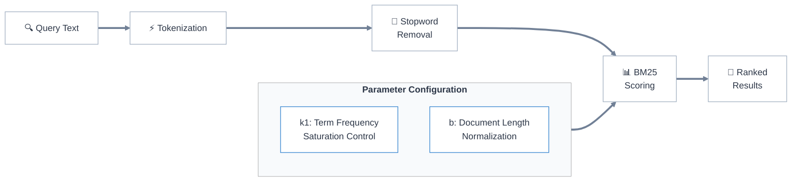

import ThemedImage from '@theme/ThemedImage';

Keyword search is an exact matching-based search using "tokens", or strings of characters.

It uses the BM25 algorithm, which ranks matching documents according to their relevance to a given search query. At a high level, the BM25 algorithm uses the count of query terms in the document (term frequency) against the overall frequency of the term in the dataset (inverse document frequency) to calculate a relevance score.

More specifically, Weaviate uses the BM25F algorithm, which extends BM25 to support using multiple fields in the search index.

A keyword search determines the best matches based on the matches of exact tokens contained in the query against those of the stored objects. As a result, a keyword search is a good choice when exact matches (e.g. exact domain-specific language, precise categories or tags) are important. For example:

- Searching for documents containing specific technical terms
- Identifying articles by precise keywords or tags

This differs from vector search, which finds semantically similar content even when the exact words don't match. You might use keyword search when precision is more important than finding related concepts.

## Keyword search in Weaviate

In Weaviate, a keyword search will return the objects best matching the query, as measured by [BM25F](https://en.wikipedia.org/wiki/Okapi_BM25) "score".

:::info BM25F vs BM25
The "F" in BM25F stands for "field", indicating that it is a field-specific version of BM25. This allows for different weights for different fields, or properties, of the objects.
 

In Weaviate, they are used interchangeably, as the BM25F algorithm is used to calculate the scores for keyword searches. Here we will refer to it generally as BM25.
:::

A BM25 score is calculated based on the frequency of the query tokens in the object properties, as well as the length of the object properties and the query.

When an input string such as `"A red Nike shoe"` is provided as the query, Weaviate will:

1. [Tokenize](#tokenization) the input (e.g. to `["a", "red", "nike", "shoe"]`)
2. With `word` tokenization, remove any [stopwords](#stopwords) (e.g. remove `a`, to produce `["red", "nike", "shoe"]`)
3. Determine the BM25 scores against [selected properties](#selected-properties) of the database objects, based on the [BM25 parameters](#bm25-parameters) and any [property boosting](#property-boosting).
4. Return the objects with the highest BM25 scores as the search results

### Tokenization

Tokenization for keyword searches refers to how each source text is split up into individual "tokens" to be compared and matched.

The built-in default tokenization method is `word`, unless overridden by server configuration.

Other tokenization methods such as `whitespace`, `lowercase`, and `field` are available, as well as specialized ones such as `gse` or `kagome_kr` for other languages ([more details](../../config-refs/collections.mdx#tokenization)).

Set tokenization [on each text property](../../search/bm25.md#set-tokenization), not on `invertedIndexConfig`.

:::info Tokenization in different contexts

The term "tokenization" is used in other contexts such as vectorization, or language generation. Note that each of these typically use different tokenizers to meet different requirements. This results in different sets of tokens, even from the same input text.

:::

:::caution Preview analyzer extensions
Accent folding, custom/per-property stopword presets, and the tokenizer inspection endpoints are preview analyzer extensions. Established BM25 search, ordinary tokenization, and collection-level stopword configuration are not made preview by this note.
:::

Supported tokenizer/analyzer combinations can also enable **accent folding** via `textAnalyzer.asciiFold`, which normalizes accented characters before tokens enter the inverted index. A document containing "Café Crème" becomes searchable as "cafe creme" (and vice versa), and the same rule applies to `Equal` and `Like` filters. See [Inverted index: Accent folding](../indexing/inverted-index.md#accent-folding) for details.

### Stopwords

Stopwords are words that are filtered out before processing text.

With `word` tokenization, Weaviate removes configured stopwords from the query terms used for BM25 scoring. This is not a universal step for every tokenizer. Analyzer settings apply to the supported `lowercase`, `trigram`, `word`, `whitespace`, and `field` tokenizers; per-property stopword presets require `word`. See [analyzer compatibility](../indexing/inverted-index.md) for details.

See the [reference page](../../config-refs/indexing/inverted-index.mdx#stopwords) for more details.

For BM25 query analysis, stopword lists are also configurable per collection **and** per property. You can define custom presets on `invertedIndexConfig.stopwordPresets` and assign them to individual text properties via `textAnalyzer.stopwordPreset`. This is useful for multilingual collections. For example, English and French properties can use different stopword lists. Stopwords remain indexed; applicable query analysis removes them rather than changing stored postings. Consequently, changing stopword configuration does not require rebuilding postings. Ordinary word-tokenized filters can also remove stopwords, while `Like` follows a wildcard-preserving path. This is not universal stopword removal for every filter/tokenizer combination. See [Inverted index: Custom stopword presets](../indexing/inverted-index.md#custom-stopword-presets) for details.

### BM25 parameters

BM25 is a scoring function used to rank documents based on the query terms appearing in them. It has two main parameters that control its behavior:

- `k1` (default: 1.2): Controls term frequency saturation. Higher values mean that multiple occurrences of a term continue to increase the score more
- `b` (default: 0.75): Controls document length normalization. Values closer to 1 mean more normalization for document length

The following diagram illustrates the `word`-tokenized BM25 analysis path; other tokenizers need not remove stopwords.

Set custom `k1` and `b` values [for a collection](../../manage-collections/inverted-index.mdx#set-inverted-index-parameters).

<!-- Set custom `k1` and `b` values [for a collection](../../manage-data/collections.mdx#set-inverted-index-parameters), or override values for each property. -->

### Keyword search operators

import SearchOperators from '/_includes/feature-notes/search-operators.mdx';

<SearchOperators/>

Search operators define how many query [tokens](../../search/bm25.md#set-tokenization) must match. The ordinary `and`/`or` single-property rules below describe the BlockMax searchable-index path. Legacy WAND matching can satisfy terms across compatible fields, so these rules are not a universal contract for every old bucket. Upgrading the server does not itself prove every property index migrated.

Conceptually, it works as though a filter is applied to the results of the BM25 score calculation. The available operators are:
- `and`: All tokens must be present within a single searched property
- `or`: At least one token must be present within a single searched property, with the minimum number of tokens being configurable (`minimumOrTokensMatch`)
- `and_cross`: Every token must be matched by at least one of the searched properties, so the tokens can be spread across different properties. All searched properties must have compatible tokenizer and analyzer settings, otherwise the query fails with an error. Compatibility is validated by the server, including applicable folding and stopword settings. (available from `v1.38.8`)

On the BlockMax path, as an example, a BM25 query of `computer networking guide` with the `and` operator would only return objects where all of the tokens `computer`, `networking`, and `guide` appear together within a single searched property. If the tokens are spread across different properties (for example, `computer` in `title` and `networking guide` in `description`), the object does not match under `and`. That restriction is specific to `and`; the same object does match under `and_cross`, which requires each token to appear in at least one of the searched properties rather than all of them in the same one. In contrast, the same query with the `or` operator would return objects where at least one of those tokens appears in a searched property. If the `or` operator is used with a `minimumOrTokensMatch` of `2`, then at least two of the tokens must be present within a single searched property.

If not specified, the default operator is `or`, with a `minimumOrTokensMatch` of `1`. At least one query token must match. The figures below illustrate matching within a single property, not a cross-format migration or heterogeneous-analyzer guarantee.

import BM25OperatorsLight from '../img/bm25_operators_light.png';
import BM25OperatorsDark from '../img/bm25_operators_dark.png';

<ThemedImage
  alt="BM25 operators"
  sources={{
    light: BM25OperatorsLight,
    dark: BM25OperatorsDark,
  }}
/>

See the [how-to page](../../search/bm25.md#search-operators) for details on usage.

### Selected properties

A BM25 query can optionally specify which object properties are to be included in the score calculations.

By default, BM25 selects eligible `text` and `text[]` properties with `indexSearchable` enabled. There are two ways to vary this:

- In the collection configuration, [set `indexSearchable` for a property to `false`](../../manage-collections/vector-config.mdx#property-level-settings). This property will then be ignored in all BM25 searches.
- [Specify which properties to search at query time](../../search/bm25.md#search-on-selected-properties-only). This applies only to that query and does not make an unsearchable property searchable: explicitly requesting a property without its searchable index fails validation.

### Property Boosting

Property boosting allows a query apply different weights to different properties when calculating the final BM25 score.

This is useful when certain properties are more important for search than others.

For example, when searching an e-commerce catalog, you could boost the title property and its categories over the product description.

<!-- This would correspond with the intuition that token matches in the title or the categories would be more significant than matches in the description. -->

[Set the property weights](../../search/bm25.md#use-weights-to-boost-properties) at query time.

## Combining with Vector Search

Keyword search can be combined with vector search in Weaviate to perform a hybrid search. This allows you to leverage both:
- Exact matching capabilities of keyword search
- Semantic understanding of vector search

See [Hybrid Search](./hybrid-search.md) for more information.

## Notes and Best Practices

Here are some key considerations when using keyword search:

1. **Tokenization Choice**
   - Choose based on your data and search requirements. For example, use `word` tokenization for natural language text, but consider `field` for URLs or email addresses that need exact matching as a whole.
   - For multilingual content, consider specialized tokenizers like `gse` for Japanese, `gse_ch` for Chinese, or `kagome_kr` for Korean
   - Consider special characters and case sensitivity needs
   - Test your tokenization choice with subsets of your data and queries to ensure it handles special characters and case sensitivity as expected. You could perform these experiments with vectorization disabled to save resources/costs, as the two processes are independent.

2. **Performance Optimization**
   - Index only the properties you need for search
   - Consider combining keyword search with vector search (i.e. perform a [hybrid search](./hybrid-search.md)) as a starting point, especially where you cannot anticipate users' behavior

3. **Query Optimization**
   - Consider boosting properties that are more important for search (e.g. title, category) over others (e.g. description)
   - Only modify `k1` and `b` values if you have a good reason to do so, as the defaults are generally well-suited for most use cases

4. **Debugging Tokenization**
   - Use the [`/v1/tokenize` endpoint](../../config-refs/indexing/inverted-index.mdx#tokenize-endpoint) to inspect how text is tokenized before committing to a schema configuration. This is useful when experimenting with accent folding or custom stopword presets.

### Further resources

- [How-to: Search](../../search/index.mdx)
- [How-to: Keyword search](../../search/bm25.md)

## Questions and feedback

import DocsFeedback from '/_includes/docs-feedback.mdx';

<DocsFeedback/>
