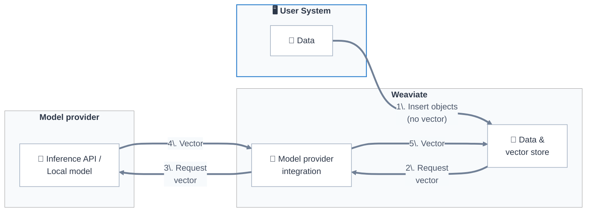
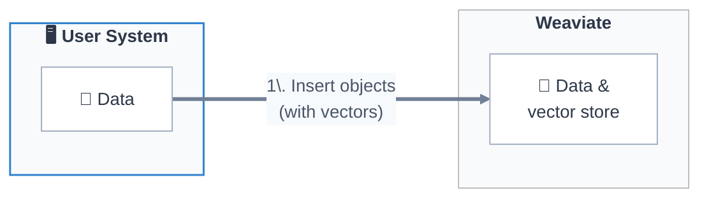

Vector search is a similarity-based search using vector embeddings, or embeddings. Vector search is also referred to as "semantic search" due to its ability to find semantically similar objects. It should be noted, however, that vector search is not limited to text data. Vector search can be used with other types of data, such as images, videos, and audio.

A vector embedding captures semantic meaning of an object in a vector space. It consists of a set of numbers that represent the object's features. Vector embeddings are generated by a vectorizer model, which is a machine learning model that is trained for this purpose.

A vector search compares [vectors of the stored objects](#object-vectors) against the [query vector(s)](#query-vectors) to find the closest matches, before returning the top `n` results.

:::tip An introduction to vector search
New to vector search? Check out our blog, ["Vector Search Explained"](https://weaviate.io/blog/vector-search-explained) for an introduction to vector search concepts and use cases.
:::

## Object vectors

To participate in a vector search, an object needs a compatible embedding for the searched target. Objects can otherwise exist without vectors.

The model used to generate vectors is called a vectorizer model, or an embedding model.

A user can populate Weaviate with objects and their vectors in one of two ways:

- Use Weaviate's [vectorizer model provider integrations](#model-provider-integration) to generate vectors
- [Provide vectors directly](#bring-your-own-vector) to Weaviate

### Model provider integration

Weaviate provides [first-party integrations with popular vectorizer model providers](../../model-providers/index.md) such as [Cohere](../../model-providers/cohere/index.md), [Ollama](../../model-providers/ollama/index.md), [OpenAI](../../model-providers/openai/index.md), and more.

In this workflow, the user can [configure a vectorizer for a collection](../../manage-collections/vector-config.mdx#specify-a-vectorizer) and Weaviate will automatically generate vectors as needed, such as when inserting objects or performing searches.

This integration abstracts the vector generation process from the user, allowing the user to focus on building applications and performing searches without worrying about the vector generation process.

:::info Vectorizer configuration is immutable

An existing vector's vectorizer identity cannot be replaced in place. To introduce another model, either [migrate to a new collection](../../manage-collections/migrate.mdx) or [add a new named vector](../../manage-collections/vector-config.mdx#add-new-named-vectors) to the existing collection. Adding the definition does not populate embeddings for existing objects: explicitly generate and write them for the new target. Some provider-approved settings can be mutable; that does not permit replacing the vectorizer identity.

:::

#### Manual vectors when vectorizer is configured

Even when a vectorizer model is configured for a collection, a user can still provide vectors directly when inserting objects or performing a query. In this case, Weaviate will use the provided vector instead of generating a new one.

This is useful when the user already has vectors generated by the same model, such as when importing objects from another system. Re-using the same vectors will save time and resources, as Weaviate will not need to generate new vectors.

### Bring your own vector

A user can directly upload vectors to Weaviate when inserting objects. This is useful when the user already has vectors generated by a model, or if the user wants to use a specific vectorizer model that does not have an integration with Weaviate.

In this workflow, the user has the flexibility to use any vectorizer model and process independently of Weaviate.

If using your own model, we recommend explicitly setting the vectorizer as `none` in the vectorizer configuration, such that you do not accidentally generate incompatible vectors with Weaviate.

### Named vectors

A collection can define multiple independent named vector spaces. Select the intended target when querying a multi-target configuration; a single configured target can be inferred. See [target selection](../../search/similarity.md#named-vectors).

Each such vector works as its distinct vector space that is independent of each other, referred to as a "named vector".

A named vector can be configured with a [vectorizer model integration](#model-provider-integration), and may be provided using the ["bring your own vector"](#bring-your-own-vector) integration.

### Multi-vector embeddings

A named vector can also hold a multi-vector embedding: a set of token- or patch-level vectors representing one object, used by late-interaction models such as ColBERT and ColPali. This differs from joining searches of several independent named vector spaces. Multi-vectors are supported on HNSW and, from v1.40, on HFresh with MUVERA encoding and self-provided vectors. See [defining multi-vector embeddings](../../manage-collections/vector-config.mdx#define-multi-vector-embeddings-eg-colbert-colpali) and the [multi-vector guide](../../configuration/compression/multi-vectors.md).

## Query vectors

In Weaviate, you can specify the query vector using:

- A query vector (called `nearVector`),
- A query object (called `nearObject`),
- A query text (called `nearText`), or
- A query media (called `nearImage` or `nearVideo`).

In each of these cases, the search will return the most similar objects to the query, based on the vector embeddings of the query and the stored objects. However, they differ in how the query vector is specified to Weaviate.

### `nearVector`

In a `nearVector` query, the user provides a vector directly to Weaviate. This vector is compared to the stored vectors in the selected target. It must use a compatible vector space, representation, and dimension, including a compatible asymmetric query/document encoder pair where applicable. Matching dimensions alone do not ensure semantic compatibility.

### `nearObject`

In a `nearObject` query, the user provides an object ID to Weaviate. Weaviate retrieves the vector of the object and compares it to the vectors of the stored objects to find the most similar objects.

### `nearText` (and `nearImage`, `nearVideo`)

In a `nearText` query, the user provides an input text to Weaviate. Weaviate uses the specified vectorizer model to generate a vector for the text, and compares it to the vectors of the stored objects to find the most similar objects.

As a result, a `nearText` query is only available for collections where a vectorizer model is configured.

A `nearImage` or `nearVideo` query works similarly to a `nearText` query, but with an image or video input instead of text.

## Multi-target vector search

In a multi-target vector search, Weaviate performs multiple, concurrent, single-target vector searches.

These searches will produce multiple sets of results, each with a vector distance score.

Weaviat combines these result sets, using a ["join strategy"](#available-join-strategies) to produce final scores for each result.

Per-target retrieval supplies candidates for the joined result set, not guaranteed final inclusions. Ranking and eligibility depend on the join strategy, final limit, and applicable thresholds. With `minimum`, an object can match through an available target vector. Other strategies require distances for all selected targets; candidates whose missing target distances cannot be retrieved are excluded. See [multi-target vector search](../../search/multi-vector.md) for configuration and join-specific behavior.

### Available join strategies.

- **minimum** (*default*) Use the minimum of all vector distances.
- **sum** Use the sum of the vector distances.
- **average** Use the average of the vector distances.
- **manual weights** Use the sum of weighted distances, where the weight is provided for each target vector.
- **relative score** Use the sum of weighted normalized distances, where the weight is provided for each target vector.

## Vector index and search

Weaviate uses vector indexes to facilitate efficient vector searches. Like other types of indexes, a vector index organizes vector embeddings in a way that allows for fast retrieval while optimizing for other needs such as search quality (e.g. recall), search throughput, and resource use (e.g. memory).

In Weaviate, multiple types of vector indexes are available such as `hnsw`, `flat`, `dynamic`, and `hfresh` indexes.

Each shard has the vector indexes configured for its targets. Collections and tenants can be vectorless or have [multiple named-vector indexes](../data.md#multiple-vector-embeddings-named-vectors), with different configurations.

:::info
Read more about:
- [Collections](../data.md#collections)
- [Multi-tenancy](../data.md#multi-tenancy)
- [Vector indexes](../indexing/vector-index.md)
- [Multiple named vectors](../data.md#multiple-vector-embeddings-named-vectors)
:::

### Distance metrics

There are many ways to measure vector distances, such as cosine distance, dot product, and Euclidean distance. Weaviate supports a variety of these distance metrics, as listed on the [distance metrics](../../config-refs/distances.md) page. Each vectorizer model is trained with a specific distance metric, so it is important to use the same distance metric for search as was used for training the model.

Weaviate uses cosine distance as the default distance metric for vector searches, as this is the typical distance metric for vectorizer models.

:::tip Distance vs Similarity
In a "distance", the lower the value, the closer the vectors are to each other. In a "similarity", or "certainty" score, the higher the value, the closer the vectors are to each other. The returned `certainty` metadata is a cosine-only transformation (`1 - distance / 2`), not a universal calibrated similarity or confidence score for other metrics.
:::

## Diversity selection (MMR)

import V137Preview from '/_includes/feature-notes/v137-preview.mdx';

<V137Preview/>

Standard vector search returns the closest matches to a query, which often means a cluster of near-duplicate results. For example, searching for "Italian food" in a product catalog might return five images of pizza instead of a diverse spread of Italian dishes.

**Maximal Marginal Relevance (MMR)** solves this by reranking results to balance two objectives:

- **Relevance**: how well does the item match the query?
- **Diversity**: how different is the item from the results already selected?

The algorithm works iteratively. It selects the most relevant item first, then for each subsequent pick it scores candidates by weighing their query similarity against their maximum similarity to any already-selected result. The `balance` parameter (λ) controls the trade-off:
- **λ = 0.0**: Pure diversity (maximizes difference from already-selected items)
- **λ = 0.5**: Balanced (each result must be both relevant and distinct)
- **λ = 1.0**: Pure relevance (equivalent to standard vector search)

MMR is applied at query time to retrieved candidates; no reindexing is needed. It supports vector and hybrid queries when the selected targets are eligible single-vector targets, not multi-vector targets. Set `balance` explicitly: the server uses `0.0` when it is omitted, but clients can send their own defaults. The search `limit` controls candidate depth; the MMR limit controls the selected result count. It cannot recover objects absent from retrieval candidates.

:::note Result ordering

During MMR selection, the first pick is the closest candidate under the selection metric; later picks balance relevance and diversity. A subsequent reranker can change this order, so this is not an unconditional final-response ordering guarantee.

:::

See the [how-to guide](../../search/similarity.md#diversity-selection-mmr) for configuration details and code examples.

## Notes and best practices

A nearest-neighbor search can return the closest available matches even when none is semantically relevant to the query. A result limit caps the number of returned matches but does not itself impose a minimum relevance threshold. Filters, missing embeddings, and thresholds can leave no eligible results; a vector query does not enumerate the whole dataset.

If you search a vector database containing vectors for colors "Red", "Crimson" and "LightCoral" with a query vector for "SkyBlue", the search will still return a result (e.g. "Red"), even if it is not semantically similar to the query. The search is simply returning the closest match, even if it is not a good match in the absolute sense.

As a result, Weaviate provides multiple ways to limit the search results:

- **Limit**: Specify the maximum number of results to return.
    - If not provided, defaults to system-defined [`QUERY_DEFAULTS_LIMIT`](/deploy/configuration/env-vars/index.md#general) of 10.
- **AutoCut**: Limit results based on discontinuities in result metrics such as vector distance or search score.
- **Threshold**: Specify a minimum similarity score (e.g. maximum cosine distance) for the results.
- **Apply filters**: Use [filters](../filtering.md) to exclude results based on other criteria, such as metadata or properties.

Use a combination of these methods to ensure that the search results are meaningful and relevant to the user.

Generally, start with a `limit` to a maximum number of results to provide to the user, and adjust the `threshold` such that irrelevant results are unlikely to be returned.

This will cause the search to return up to the specified (`limit`) number of results, but only if they are above the specified (`threshold`) similarity score.

### Further resources

- [How-to: Search](../../search/index.mdx)
- [How-to: Vector similarity search](../../search/similarity.md)

## Questions and feedback

import DocsFeedback from '/_includes/docs-feedback.mdx';

<DocsFeedback/>
