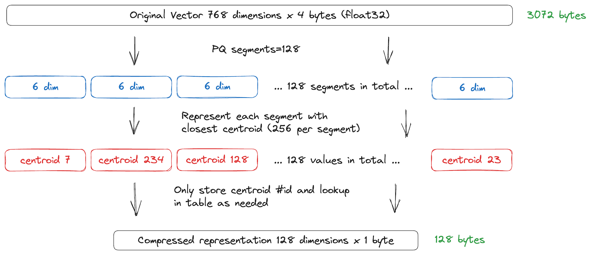

import Rq8bit from '/_includes/feature-notes/rq-8bit.mdx';
import Rq4bit from '/_includes/feature-notes/rq-4bit.mdx';
import Rq1bit from '/_includes/feature-notes/rq-1bit.mdx';

**Vector quantization** compresses vector embeddings and can reduce the memory footprint of the [vector index](./indexing/vector-index.md). Cost, throughput, and recall depend on the workload, quantizer, encoding, rescoring, and I/O. Code-width ratios below describe compressed payloads, not total RAM, disk, or deployment-cost savings. Original vectors remain stored for exact scoring; graph, object/property indexes, metadata, and caches contribute separately.

Weaviate currently offers four vector quantization techniques:

- [Binary quantization (BQ)](#binary-quantization)
- [Product quantization (PQ)](#product-quantization)
- [Scalar quantization (SQ)](#scalar-quantization)
- [Rotational quantization (RQ)](#rotational-quantization)

import CompressionByDefault from '/\_includes/compression-by-default.mdx';

<CompressionByDefault/>

## What is quantization?

In general, quantization techniques reduce the memory footprint by representing numbers with lower precision numbers, like rounding a number to the nearest integer. In neural networks, quantization reduces the values of the weights or activations of the model stored as a 32-bit floating-point number (4 bytes) to a lower precision number, such as an 8-bit integer (1 byte).

### What is vector quantization?

Vector quantization is a technique that reduces the memory footprint of vector embeddings. Vector embeddings have been typically represented as 32-bit floating-point numbers. Vector quantization techniques reduce the size of the vector embeddings by representing them as smaller numbers, such as 8-bit integers or binary numbers. Some quantization techniques also reduce the number of dimensions in the vector embeddings.

## Product quantization

[Product quantization](https://ieeexplore.ieee.org/document/5432202) is a multi-step quantization technique that is available for use with `hnsw` indexes in Weaviate.

PQ partitions the original coordinates into a configured number of equal-sized subvectors (segments), then represents each segment by a centroid ID from a trained codebook. It does not first transform the embedding into a different, lower-dimensional vector space.

import PQTradeoffs from '/\_includes/configuration/pq-compression/tradeoffs.mdx' ;

<PQTradeoffs />

In PQ, the original vector embedding is represented as a product of smaller vectors that are called 'segments' or 'subspaces.' Then, each segment is quantized independently to create a compressed vector embedding.

After the segments are created, there is a training step to calculate `centroids` for each segment. By default, Weaviate clusters each segment into 256 centroids. The centroids make up a codebook that Weaviate uses in later steps to compress the vector embeddings.

Once the codebook is ready, Weaviate uses the id of the closest centroid to compress each vector segment. The new vector embedding reduces memory consumption significantly. Imagine a collection where each vector embedding has 768 four byte elements. Before PQ compression, the original float payload requires `768 x 4 = 3072` bytes. With `segments=128` and 256 centroids per segment, the compressed code requires `128 x 1 = 128` bytes: a 24x raw code-width ratio before codebook/other overhead. This is not a 24x reduction in total storage or instance memory.

To enable PQ compression, see [Enable PQ compression](/weaviate/configuration/compression/pq-compression#enable-pq-compression)

### Segments

The PQ `segments` controls the tradeoff between memory and recall. A larger `segments` parameter means higher memory usage and recall. An important thing to note is that the segments must divide evenly the original vector dimension.

Below is a list segment values for common vectorizer modules:

| Module      | Model                                   | Dimensions | Segments               |
| ----------- | --------------------------------------- | ---------- | ---------------------- |
| openai      | text-embedding-ada-002                  | 1536       | 512, 384, 256, 192, 96 |
| cohere      | multilingual-22-12                      | 768        | 384, 256, 192, 96      |
| huggingface | sentence-transformers/all-MiniLM-L12-v2 | 384        | 192, 128, 96           |

### PQ compression process

PQ has a training stage where it creates a codebook. We recommend using 10,000 to 100,000 records per shard to create the codebook. The training step can be triggered manually or automatically. See [Configuration: Product quantization](../configuration/compression/pq-compression.md) for more details.

Training triggers background conversion to the compressed index; this is not a shard-wide `READONLY` to `READY` cycle. Conversion can block vector-index operations. With asynchronous indexing, queue processing pauses for conversion and resumes afterward; incoming vector writes can queue, so vector-search visibility can lag. Background conversion is not a zero-downtime guarantee.

Weaviate uses a maximum of `trainingLimit` objects (per shard) for training, even if there are more objects available.

Compression changes candidate selection and can affect recall. Exact rescoring of retrieved candidates uses originals, but cannot recover candidates that were never retrieved.

:::info Which objects are used for training?

- (`v1.27` and later) If the collection has more objects than the training limit, Weaviate randomly selects objects from the collection to train the codebook.
- (`v1.26` and earlier) Weaviate uses the first `trainingLimit` objects in the collection to train the codebook.
- If the collection has fewer objects than the training limit, Weaviate uses all objects in the collection to train the codebook.

:::

### Encoders

In the configuration above you can see that you can set the `encoder` object to specify how the codebook centroids are generated. Weaviate's PQ supports using two different encoders. The default is `kmeans` which maps to the traditional approach used for creating centroid.

Alternatively, there is also the `tile` encoder. This encoder is experimental; evaluate its import cost and recall on your workload rather than assuming a performance improvement. The `tile` encoder has an additional `distribution` parameter that controls what distribution to use when generating centroids. You can configure the encoder by setting `type` to `tile` or `kmeans` the encoder creates the codebook for product quantization. For configuration details, see [Configuration: Vector index](../config-refs/indexing/vector-index.mdx).

### Distance calculation

With product quantization, distances are then calculated asymmetrically with a query vector with the goal being to keep all the original information in the query vector when calculating distances.

:::tip
Learn more about [how to configure product quantization in Weaviate](../configuration/compression/pq-compression.md).  
You might be also interested in our blog post [How to Reduce Memory Requirements by up to 90%+ using Product Quantization](https://weaviate.io/blog/pq-rescoring).
:::

## Binary quantization

**Binary quantization (BQ)** is a quantization technique that converts each vector embedding to a binary representation. The binary representation is much smaller than the original vector embedding. Usually each vector dimension requires 32 bits, but the binary representation only requires 1 bit, representing a nominal 32x raw code-width reduction before metadata and retained-original storage. Smaller codes can reduce I/O and simplify approximate distance calculations, but do not guarantee total-storage savings or faster end-to-end queries.

The tradeoff is that BQ is lossy. The binary representation by nature omits a significant amount of information, and as a result the distance calculation is not as accurate as the original vector embedding.

Some vectorizers work better with BQ than others. Anecdotally, we have seen encouraging recall with Cohere's V3 models (e.g. `embed-multilingual-v3.0` or `embed-english-v3.0`), and OpenAI's `ada-002` model with BQ enabled. We advise you to test BQ with your own data and preferred vectorizer to determine if it is suitable for your use case.

Note that when BQ is enabled, a vector cache can be used to improve query performance. The vector cache is used to speed up queries by reducing the number of disk reads for the quantized vector embeddings. Note that it must be balanced with memory usage considerations, with each vector taking up `n_dimensions` bits.

## Scalar quantization

**Scalar quantization (SQ)** The dimensions in a vector embedding are usually represented as 32 bit floats. SQ transforms the float representation to an 8 bit integer. This is a 4x reduction in size.

SQ compression, like BQ, is a lossy compression technique. However, SQ has a much greater range. The SQ algorithm analyzes your data and distributes the dimension values into 256 buckets (8 bits).

SQ retains more coordinate precision than a sign-only code, but relative recall depends on the data and search configuration. Its codes are smaller than float32 payloads, not a guarantee of a corresponding whole-index reduction.

The bucket boundaries are derived by determining the minimum and maximum values in a training set, and uniformly distributing the values between the minimum and maximum into 256 buckets. The 8 bit integer is then used to represent the bucket number.

The size of the training set is configurable. The default is 100,000 objects per shard.

When SQ rescoring is enabled, Weaviate recalculates distances for retrieved candidates using original vectors. This can improve candidate ordering at additional I/O/compute cost. Candidate breadth and rescoring controls depend on the index, as described [below](#over-fetching--re-scoring).

## Rotational quantization

**Rotational quantization (RQ)** compresses rotated vectors. Ordinary RQ is training-free and can be enabled at index creation; opt-in centered 4-bit RQ instead fits a mean from sampled vectors before compression. Recall and throughput depend on the workload and rescoring configuration. RQ is available in: **8-bit**, **4-bit** and **1-bit** variants.

### 8-bit RQ

<Rq8bit/>

8-bit RQ approaches a 4x raw code-width reduction at high dimensions, before metadata and other index/storage overhead. The method works as follows:

1. **Fast pseudorandom rotation**: The input vector is transformed using a fast rotation based on the Walsh Hadamard Transform. The output dimension is rounded up to the nearest multiple of 64.

2. **Scalar quantization**: Each entry of the rotated vector is quantized to an 8-bit integer. The minimum and maximum values of each individual rotated vector define the quantization interval.

### 4-bit RQ

<Rq4bit/>

4-bit RQ stores each dimension of the rotated vector in 4 bits, so a compressed vector is about half the size of the 8-bit equivalent and roughly 8x smaller than the uncompressed vector. It sits between 8-bit RQ and 1-bit RQ: it gives up some accuracy in the compressed distance calculation in exchange for a smaller index.

The method works as follows:

1. **Fast pseudorandom rotation**: The same rotation process as 8-bit RQ is applied to the input vector, and the output dimension is rounded up to the nearest multiple of 64. Because the output dimension is always a multiple of 64, two codes always pack cleanly into one byte.

2. **Asymmetric quantization**:
   - **Data vectors**: Quantized to 4 bits per dimension using a per-vector interval that can be tightened to reduce quantization error. Two codes are packed into each stored byte.
   - **Query vectors**: Scalar quantized using 8 bits per dimension during search.

Quantizing queries at higher precision than stored data uses no extra persistent vector-code storage, but query processing still has a cost.

Optional **centering** for HNSW RQ4 estimates a shared mean from a sample and subtracts it before rotation/quantization. It is off by default and can delay automatic compression while the sample is collected. Its recall benefit depends on the embedding distribution. See [4-bit RQ configuration](../configuration/compression/rq-compression.md#4-bit-rq) for `centering`, `trainingLimit`, and restrictions.

Coarser codes can benefit from [rescoring](#over-fetching--re-scoring), but neither native recall nor a particular rescoring depth guarantees a fixed recall percentage. Evaluate the trade-off with your queries and data.

### 1-bit RQ

<Rq1bit/>

1-bit RQ is an asymmetric quantization method approaching a 32x raw code-width reduction at high dimensions. Rotation and higher-precision queries can make it a useful alternative to BQ, but recall and throughput comparisons with BQ or PQ are workload-dependent.

The method works as follows:

1. **Fast pseudorandom rotation**: The same rotation process as 8-bit RQ is applied to the input vector. For 1-bit RQ, the output dimension is always padded to at least 256 bits to improve performance on low-dimensional data.

2. **Asymmetric quantization**:
   - **Data vectors**: Quantized using 1 bit per dimension by storing only the sign of each entry
   - **Query vectors**: Scalar quantized using 5 bits per dimension during search

The query representation retains more precision than the stored sign-only codes. This is designed to improve distance estimation over a symmetric sign-only comparison, not a universal recall ranking across quantizers or datasets.

### RQ characteristics

The rotation step provides multiple benefits. It tends to reduce the quantization interval and decrease quantization error by distributing values more uniformly. It also distributes the distance information more evenly across all dimensions, providing a better starting point for distance estimation.

All RQ variants round up the number of dimensions to multiples of 64, which means that low-dimensional data (< 64 or 128 dimensions) might result in less than optimal compression. Additionally, several factors affect the actual compression rates:

- **Auxiliary data storage**: 16 bytes for 8-bit and ordinary 4-bit RQ, and 8 bytes for 1-bit RQ, are stored with the compressed codes. Centered 4-bit RQ uses 20 bytes when its padded output dimension exceeds 4096
- **Dimension rounding**: Dimensionality is rounded up to the nearest multiple of 64 and 1-bit RQ is also padded to at least 256 bits

Due to these factors, the 4x, 8x and 32x compression rates are only approached as dimensionality increases. These effects are more pronounced for low-dimensional vectors.

While inspired by extended [RaBitQ](https://arxiv.org/abs/2405.12497), this implementation differs significantly for performance reasons. It uses fast pseudorandom rotations instead of truly random rotations.
:::tip

Learn more about how to [configure rotational quantization](../configuration/compression/rq-compression.md) in Weaviate or dive deer into the [implementation details and theoretical background](https://weaviate.io/blog/8-bit-rotational-quantization).

:::

## Over-fetching / re-scoring

When enabled, exact rescoring recalculates distances against original vectors for retrieved compressed-search candidates. This includes PQ as well as SQ, RQ, and BQ paths. It improves ordering within the candidate pool, not an exhaustive nearest-neighbor guarantee.

- **HNSW**: `ef` governs ANN candidate search. Ordinary single-vector SQ/RQ `rescoreLimit` can trim the available candidate heap when the configured value is at least the query limit; it does not raise `ef` or force retrieval of that many candidates. Setting it to `0` disables this SQ/RQ rescoring path. PQ/BQ do not have the same HNSW SQ/RQ limit control.
- **Flat**: Quantized search retains up to `max(query limit, rescoreLimit)` candidates and then scores their original vectors. For a query limit of 10 and rescore limit of 200, it can retain up to 200 eligible candidates before returning up to 10. Setting `rescoreLimit=0` still rescores up to the query limit; it does not disable flat rescoring.

These controls do not disable late-interaction exact scoring. Multi-vector and HFresh paths have their own candidate/scoring mechanisms. Consult the [index reference](../config-refs/indexing/vector-index.mdx) and compression guides, and measure recall, latency, and I/O before reducing candidate breadth or rescoring.

## Vector compression with vector indexing

### With an HNSW index

An [HNSW index](./indexing/vector-index.md#hierarchical-navigable-small-world-hnsw-index) can be configured using [PQ](#product-quantization), [SQ](#scalar-quantization), [RQ](#rotational-quantization), or [BQ](#binary-quantization). Since HNSW is in memory, compression can reduce your memory footprint or allow you to store more data in the same amount of memory.

If memory is your main constraint, consider the disk-backed [HFresh index](./indexing/vector-index.md#hfresh-index) as an alternative to keeping the HNSW graph and vector cache resident, not as an alternative to quantization itself. HFresh uses an 8-bit RQ centroid index and built-in 1-bit RQ posting vectors, with originals used for final scoring.

:::tip
You might be also interested in our blog post [HNSW+PQ - Exploring ANN algorithms Part 2.1](https://weaviate.io/blog/ann-algorithms-hnsw-pq).
:::

### With a flat index

[RQ](#rotational-quantization) and [BQ](#binary-quantization) can be applied to a [flat index](./indexing/vector-index.md#flat-index). A flat index scans compact codes to select candidates, then reads originals for rescoring. This can reduce candidate-scan I/O, but end-to-end speed depends on the workload and rescoring cost.

A flat index accepts 8-bit and 1-bit RQ. [4-bit RQ](#4-bit-rq) is available for the HNSW index only.

## Rescoring

Quantization reduces precision during candidate search. Exact rescoring ranks retrieved candidates using original vectors, but cannot restore an unseen nearest neighbor or guarantee the globally most accurate result set. The [index-specific controls above](#over-fetching--re-scoring) determine candidate breadth and which originals are scored.

## Further resources

:::info Related pages

- [Concepts: Indexing](./indexing/index.md)
- [Concepts: Vector Indexing](./indexing/vector-index.md)
- [Configuration: Vector index](../config-refs/indexing/vector-index.mdx)
- [Configuration: Schema (Configure semantic indexing)](../config-refs/indexing/vector-index.mdx#configure-semantic-indexing)
- [How to configure: Binary quantization (compression)](../configuration/compression/bq-compression.md)
- [How to configure: Product quantization (compression)](../configuration/compression/pq-compression.md)
- [How to configure: Scalar quantization (compression)](../configuration/compression/sq-compression.md)
- [How to configure: Rotational quantization (compression)](../configuration/compression/rq-compression.md)
:::

## Questions and feedback

import DocsFeedback from '/\_includes/docs-feedback.mdx';

<DocsFeedback/>
