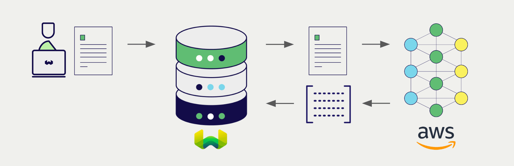
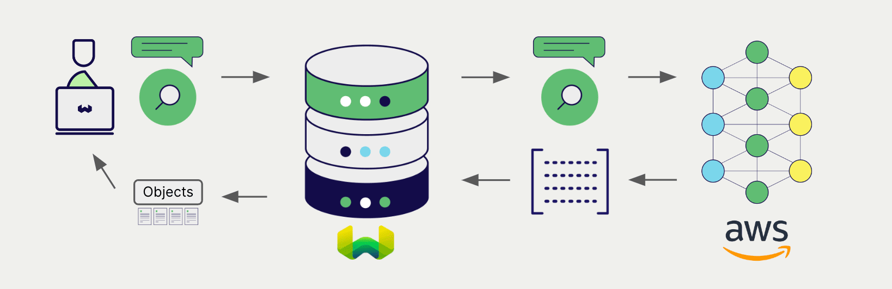

# AWS Multimodal Embeddings with Weaviate

import Tabs from '@theme/Tabs';
import TabItem from '@theme/TabItem';
import FilteredTextBlock from '@site/src/components/Documentation/FilteredTextBlock';
import PyConnect from '!!raw-loader!../_includes/provider.connect.py';
import PyCode from '!!raw-loader!../_includes/provider.vectorizer.py';

Weaviate's integration with AWS's [Bedrock](https://aws.amazon.com/bedrock/) API allows you to access their models' capabilities directly from Weaviate.

[Configure a Weaviate vector index](#configure-the-vectorizer) to use an AWS embedding model, and Weaviate will generate embeddings for various operations using the specified model and your AWS API credentials. This feature is called the *vectorizer*.

At [import time](#data-import), Weaviate generates multimodal object embeddings from text and images and saves them into the index. For [vector](#vector-near-text-search) and [hybrid](#hybrid-search) search operations, Weaviate converts text queries into embeddings. [Near image search](#vector-near-image-search) is also supported.

## Requirements

### Weaviate configuration

Your Weaviate instance must be configured with the AWS multimodal vectorizer integration (`multi2vec-aws`) module.

  
For Weaviate Cloud (WCD) users

This integration is enabled by default on Weaviate Cloud (WCD) instances.

  
For self-hosted users

- Check the [cluster metadata](/deploy/configuration/status.md#cluster-metadata) to verify if the module is enabled.
- Follow the [how-to configure modules](../../configuration/modules.md) guide to enable the module in Weaviate.

### API credentials

You must provide [access key based AWS credentials](https://docs.aws.amazon.com/IAM/latest/UserGuide/id_credentials_access-keys.html) to Weaviate for these integrations. Go to [AWS](https://aws.amazon.com/) to sign up and obtain an AWS access key ID and a corresponding AWS secret access key.

Provide the API credentials to Weaviate using one of the following methods:

- Set the `AWS_ACCESS_KEY` and `AWS_SECRET_KEY` environment variables that are available to Weaviate.
- Provide the API credentials at runtime, as shown in the examples below.

<Tabs className="code" groupId="languages">

 <TabItem value="py" label="Python">
    <FilteredTextBlock
      text={PyConnect}
      startMarker="# START AWSInstantiation"
      endMarker="# END AWSInstantiation"
      language="py"
    />
  </TabItem>

</Tabs>

## Configure the vectorizer

[Configure a Weaviate index](../../manage-collections/vector-config.mdx#specify-a-vectorizer) as follows to use an AWS embedding model:

<Tabs className="code" groupId="languages">
  <TabItem value="py" label="Python">
    <FilteredTextBlock
      text={PyCode}
      startMarker="# START BasicMMVectorizerAWS"
      endMarker="# END BasicMMVectorizerAWS"
      language="py"
    />
  </TabItem>

</Tabs>

You can [specify](#vectorizer-parameters) a model for Weaviate to use. If you do not set a model, Weaviate uses the [server default](#available-models).

import VectorizationBehavior from '/_includes/vectorization.behavior.mdx';

  
Vectorization behavior

<VectorizationBehavior/>

### Vectorizer parameters

- `region` (Required): The AWS region to send requests to, e.g. `us-east-1`.
- `model` (Optional): The full Bedrock model identifier. Defaults to `amazon.titan-embed-image-v1`.
- `dimensions` (Optional): The size of the embedding to request from the model. Weaviate sends it only when it is set. Cohere models ignore it.
- `textFields` and `imageFields`: The text and image properties to vectorize. You can give each property a weight.

The following example shows how to configure AWS-specific options.

<Tabs className="code" groupId="languages">
  <TabItem value="py" label="Python">
    <FilteredTextBlock
      text={PyCode}
      startMarker="# START FullMMVectorizerAWS"
      endMarker="# END FullMMVectorizerAWS"
      language="py"
    />
  </TabItem>

</Tabs>

## Data import

After configuring the vectorizer, [import data](../../manage-objects/import.mdx) into Weaviate. Weaviate generates embeddings for the objects using the specified model.

<Tabs className="code" groupId="languages">

 <TabItem value="py" label="Python">
    <FilteredTextBlock
      text={PyCode}
      startMarker="# START MMBatchImportExample"
      endMarker="# END MMBatchImportExample"
      language="py"
    />
  </TabItem>

</Tabs>

:::tip Re-use existing vectors
If you already have a compatible model vector available, you can provide it directly to Weaviate. This can be useful if you have already generated embeddings using the same model and want to use them in Weaviate, such as when migrating data from another system.
:::

## Searches

Once the vectorizer is configured, Weaviate will perform vector and hybrid search operations using the specified AWS model.

### Vector (near text) search

When you perform a [vector search](../../search/similarity.md#search-with-text), Weaviate converts the text query into an embedding using the specified model and returns the most similar objects from the database.

The query below returns the `n` most similar objects from the database, set by `limit`.

<Tabs className="code" groupId="languages">

 <TabItem value="py" label="Python">
    <FilteredTextBlock
      text={PyCode}
      startMarker="# START NearTextExample"
      endMarker="# END NearTextExample"
      language="py"
    />
  </TabItem>

</Tabs>

### Hybrid search

:::info What is a hybrid search?
A hybrid search performs a vector search and a keyword (BM25) search, before [combining the results](../../search/hybrid.md) to return the best matching objects from the database.
:::

When you perform a [hybrid search](../../search/hybrid.md), Weaviate converts the text query into an embedding using the specified model and returns the best scoring objects from the database.

The query below returns the `n` best scoring objects from the database, set by `limit`.

<Tabs className="code" groupId="languages">

 <TabItem value="py" label="Python">
    <FilteredTextBlock
      text={PyCode}
      startMarker="# START HybridExample"
      endMarker="# END HybridExample"
      language="py"
    />
  </TabItem>

</Tabs>

### Vector (near image) search

When you perform a [near image search](../../search/similarity.md#search-with-image), Weaviate converts the query into an embedding using the specified model and returns the most similar objects from the database.

To perform a near image search, convert the image query into a base64 string and pass it to the search query.

The query below returns the `n` most similar objects to the input image from the database, set by `limit`.

<Tabs className="code" groupId="languages">

 <TabItem value="py" label="Python">
    <FilteredTextBlock
      text={PyCode}
      startMarker="# START NearImageExample"
      endMarker="# END NearImageExample"
      language="py"
    />
  </TabItem>

</Tabs>

## References

### Available models

Weaviate does not validate the model name. The model ID must contain `amazon.` or `cohere.`, or imports fail with an `unknown model provider` error.

The server default is `amazon.titan-embed-image-v1`.

See the [Amazon Bedrock Models at a glance page](https://docs.aws.amazon.com/bedrock/latest/userguide/model-cards.html) for the list of available models.

## Further resources

### Other integrations

- [AWS text embedding models + Weaviate](./embeddings.md)
- [AWS generative models + Weaviate](./generative.md)

### Code examples

Once the integrations are configured at the collection, the data management and search operations in Weaviate work identically to any other collection. See the following model-agnostic examples:

- The [How-to: Manage collections](../../manage-collections/index.mdx) and [How-to: Manage objects](../../manage-objects/index.mdx) guides show how to perform data operations (i.e. create, read, update, delete collections and objects within them).
- The [How-to: Query & Search](../../search/index.mdx) guides show how to perform search operations (i.e. vector, keyword, hybrid) as well as retrieval augmented generation.

### External resources

- AWS [Bedrock documentation](https://docs.aws.amazon.com/bedrock/)

## Questions and feedback

import DocsFeedback from '/_includes/docs-feedback.mdx';

<DocsFeedback/>
