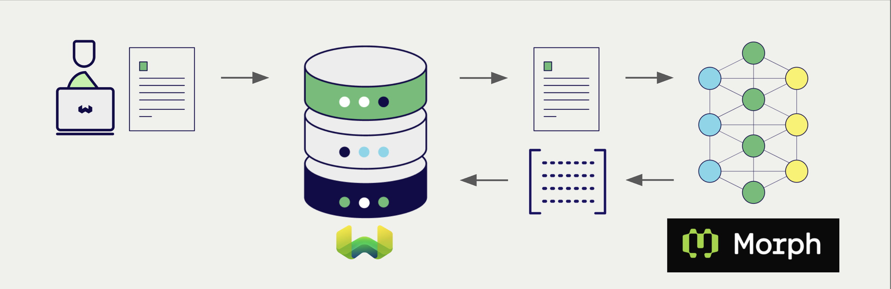

<!-- Note: for images, use https://docs.google.com/presentation/d/15opIcJuaIjEEcs_1Zm8B6pccox2p7_MHSjCnRv4dPfU/edit?usp=sharing -->

[Morph](https://morphllm.com/) serves code and text embedding models behind an OpenAI-compatible API. Weaviate integrates with Morph's embedding endpoint so you can vectorize and search data using Morph-hosted models directly from your Weaviate instance.

:::caution Morph does not list the Embeddings API among its public endpoints
Morph's API documentation currently lists only `/v1/chat/completions` and `/v1/messages`, and the Weaviate default model `morph-embedding-v3` is not in Morph's public model catalog. Morph's current embedding examples use `morph-embedding-v4`. Confirm the model ID with the [List Models](https://docs.morphllm.com/api-reference/endpoint/models) endpoint before you build on this integration.
:::

## Integrations with Morph

### Embedding models for vector search

Morph exposes embedding models over an OpenAI-compatible `/v1/embeddings` API at `https://api.morphllm.com`.

[Weaviate integrates with Morph's embedding models](./embeddings.md) through the `text2vec-morph` vectorizer module. Configure a vector index to use a Morph model and Weaviate generates embeddings for imports, vector searches, and hybrid searches automatically.

[Morph embedding integration page](./embeddings.md)

## Summary

This integration lets you use Morph's hosted embedding models from Weaviate without managing inference infrastructure yourself.

## Get started

Generate an API key in the [Morph dashboard](https://morphllm.com/), then supply it to Weaviate through the `MORPH_APIKEY` environment variable or the `X-Openai-Api-Key` request header. The header name is shared with the OpenAI integration, because Morph requests are built by the same OpenAI-compatible client inside Weaviate. Then see the embedding integration page:

- [Text Embeddings](./embeddings.md)

## Questions and feedback

import DocsFeedback from '/_includes/docs-feedback.mdx';

<DocsFeedback/>
