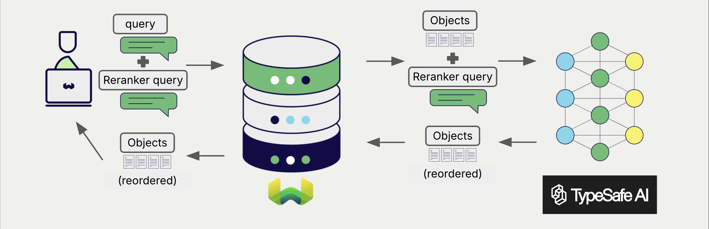

<!-- Note: for images, use https://docs.google.com/presentation/d/15opIcJuaIjEEcs_1Zm8B6pccox2p7_MHSjCnRv4dPfU/edit?usp=sharing -->

TypeSafe AI offers decision models that judge whether a condition holds for a text or an image. Weaviate seamlessly integrates with TypeSafe AI's APIs, allowing users to leverage TypeSafe AI's models directly from the Weaviate Database.

These integrations empower developers to build sophisticated AI-driven applications with ease.

## Integrations with TypeSafe AI

### Reranker models

<!-- TODO(Ivan): replace placeholder image -->

TypeSafe AI's reranker models score each search result by the probability that a condition holds for it, such as "The customer is about to churn".

[The Weaviate reranker integration](./reranker.md) allows users to reorder their search results by that probability.

[TypeSafe AI reranker integration page](./reranker.md)

## Summary

These integrations enable developers to leverage TypeSafe AI's powerful models directly within Weaviate.

In turn, they simplify the process of building AI-driven applications to speed up your development process, so that you can focus on creating innovative solutions.

## Get started

You must provide a valid TypeSafe AI API key to Weaviate for these integrations. Go to the [TypeSafe AI console](https://console.typesafe.ai/) to sign up and obtain an API key.

Then, go to the relevant integration page to learn how to configure Weaviate with the TypeSafe AI models and start using them in your applications.

- [Reranker](./reranker.md)

## Questions and feedback

import DocsFeedback from '/_includes/docs-feedback.mdx';

<DocsFeedback/>
