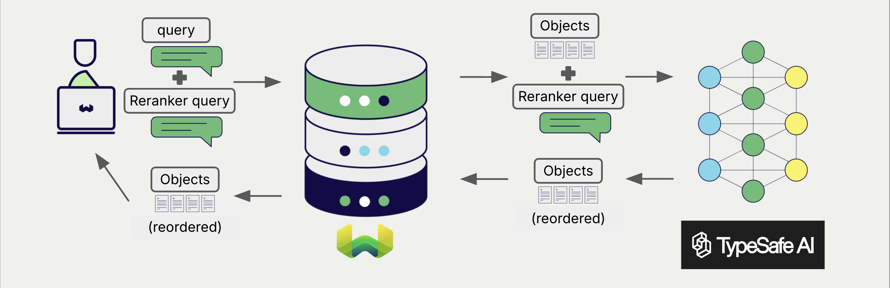

# TypeSafe AI Reranker Models with Weaviate

import Tabs from '@theme/Tabs';
import TabItem from '@theme/TabItem';
import FilteredTextBlock from '@site/src/components/Documentation/FilteredTextBlock';
import PyCode from '!!raw-loader!../_includes/provider.reranker.decision.py';

Weaviate's integration with TypeSafe AI's APIs allows you to access their models' capabilities directly from Weaviate.

[Configure a Weaviate collection](#configure-the-reranker) to use a TypeSafe AI reranker model, and Weaviate will use the specified model and your TypeSafe AI API key to rerank search results.

This two-step process involves Weaviate first performing a search and then reranking the results using the specified model.

TypeSafe AI's reranker models are decision models. The rerank query is a condition, such as "The customer is about to churn". The rerank score is the probability that the condition holds, from 0 to 1. See [Decision models](../../concepts/reranking.md#decision-models) to learn how to write a condition.

<!-- TODO(Ivan): replace placeholder image -->

:::info Python client release
The Python examples on this page need the next Python client release. See the [Python client releases](https://github.com/weaviate/weaviate-python-client/releases).
:::

## Requirements

### Weaviate configuration

Your Weaviate instance must be configured with the TypeSafe AI reranker integration (`reranker-typesafeai`) module. This module is available from Weaviate `v1.41`.

  
For Weaviate Cloud (WCD) users

This integration is enabled by default on Weaviate Cloud (WCD) instances.

  
For self-hosted users

- Check the [cluster metadata](/deploy/configuration/status.md#cluster-metadata) to verify if the module is enabled.
- Follow the [how-to configure modules](../../configuration/modules.md) guide to enable the module in Weaviate.

### API credentials

You must provide a valid TypeSafe AI API key to Weaviate for this integration. Go to the [TypeSafe AI console](https://console.typesafe.ai/) to sign up and obtain an API key.

Provide the API key to Weaviate using one of the following methods:

- Set the `TYPESAFEAI_APIKEY` environment variable that is available to Weaviate.
- Provide the API key at runtime, as shown in the examples below.

<Tabs className="code" groupId="languages">

 <TabItem value="py" label="Python">
    <FilteredTextBlock
      text={PyCode}
      startMarker="# START TypeSafeAIInstantiation"
      endMarker="# END TypeSafeAIInstantiation"
      language="py"
    />
  </TabItem>

</Tabs>

## Configure the reranker

import MutableRerankerConfig from '/_includes/mutable-reranker-config.md';

<MutableRerankerConfig />

Configure a Weaviate collection to use a TypeSafe AI reranker model as follows:

<Tabs className="code" groupId="languages">
  <TabItem value="py" label="Python">
    <FilteredTextBlock
      text={PyCode}
      startMarker="# START RerankerTypeSafeAIBasic"
      endMarker="# END RerankerTypeSafeAIBasic"
      language="py"
    />
  </TabItem>

</Tabs>

### Select a model

You can specify one of the [available models](#available-models) for Weaviate to use, as shown in the following configuration example:

<Tabs className="code" groupId="languages">
  <TabItem value="py" label="Python">
    <FilteredTextBlock
      text={PyCode}
      startMarker="# START RerankerTypeSafeAICustomModel"
      endMarker="# END RerankerTypeSafeAICustomModel"
      language="py"
    />
  </TabItem>

</Tabs>

The [default model](#available-models) is used if no model is specified.

## Header parameters

You can provide the API key as well as some optional parameters at runtime through additional headers in the request. The following headers are available:

- `X-Typesafeai-Api-Key`: The TypeSafe AI API key.
- `X-Typesafeai-Baseurl`: The base URL to use (e.g. a proxy) instead of the default TypeSafe AI URL. Give the host only. Weaviate appends the API path, so a base URL that ends in `/v1` fails.

Any additional headers provided at runtime will override the existing Weaviate configuration.

Provide the headers as shown in the [API credentials examples](#api-credentials) above.

## Reranking query

Once the reranker is configured, Weaviate performs [reranking operations](../../search/rerank.md) using the specified TypeSafe AI model.

More specifically, Weaviate performs an initial search, then reranks the results using the specified model.

Any search in Weaviate can be combined with a reranker to perform reranking operations.

The rerank query is required. See [rerank query requirements](../../search/rerank.md#rerank-query-requirements) for the checks that run before the search.

<!-- TODO(Ivan): replace placeholder image -->

<Tabs className="code" groupId="languages">

 <TabItem value="py" label="Python">
    <FilteredTextBlock
      text={PyCode}
      startMarker="# START RerankerDecisionQuery"
      endMarker="# END RerankerDecisionQuery"
      language="py"
    />
  </TabItem>

</Tabs>

:::caution Reranking is billed per request
Weaviate sends one billed request to TypeSafe AI per 50 texts on the page, and one per image.
:::

The reranker does not remove results. Every object stays on the page, sorted by rerank score. To keep only the objects where the condition holds, filter on the score yourself:

<Tabs className="code" groupId="languages">

 <TabItem value="py" label="Python">
    <FilteredTextBlock
      text={PyCode}
      startMarker="# START RerankerDecisionThreshold"
      endMarker="# END RerankerDecisionThreshold"
      language="py"
    />
  </TabItem>

</Tabs>

The model can also judge images. Rerank on a `blob` property that holds a base64-encoded PNG or JPEG image of 280 to 1,568 pixels per side. Image input is not yet production-ready at TypeSafe AI. See [TypeSafe AI's image documentation](https://docs.typesafe.ai/images).

<Tabs className="code" groupId="languages">

 <TabItem value="py" label="Python">
    <FilteredTextBlock
      text={PyCode}
      startMarker="# START RerankerDecisionImage"
      endMarker="# END RerankerDecisionImage"
      language="py"
    />
  </TabItem>

</Tabs>

## References

### Available models

- `jev-latest` (server default). This alias points to the most recent stable release.
- `jev-1.14.0`
- `jev-1.13.0`

Weaviate does not validate the model name. See [TypeSafe AI's model documentation](https://docs.typesafe.ai/models) for the current list.

## Further resources

### Code examples

Once the integrations are configured at the collection, the data management and search operations in Weaviate work identically to any other collection. See the following model-agnostic examples:

- The [How-to: Manage collections](../../manage-collections/index.mdx) and [How-to: Manage objects](../../manage-objects/index.mdx) guides show how to perform data operations (i.e. create, read, update, delete collections and objects within them).
- The [How-to: Query & Search](../../search/index.mdx) guides show how to perform search operations (i.e. vector, keyword, hybrid) as well as retrieval augmented generation.

### References

- TypeSafe AI [model documentation](https://docs.typesafe.ai/models)

## Questions and feedback

import DocsFeedback from '/_includes/docs-feedback.mdx';

<DocsFeedback/>
